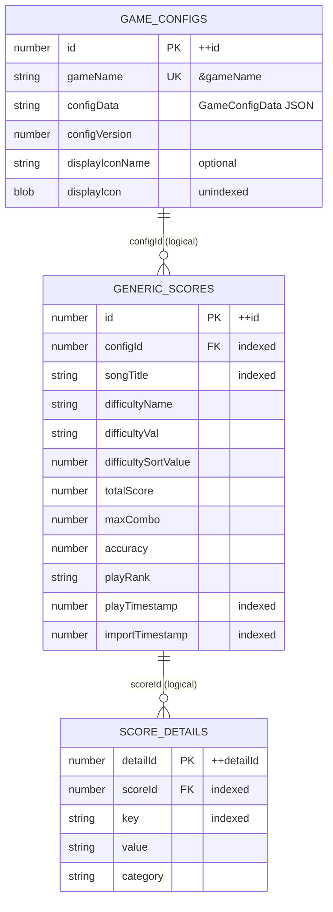
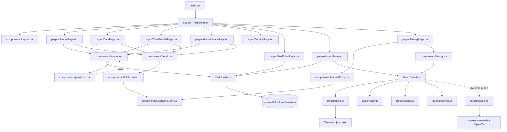
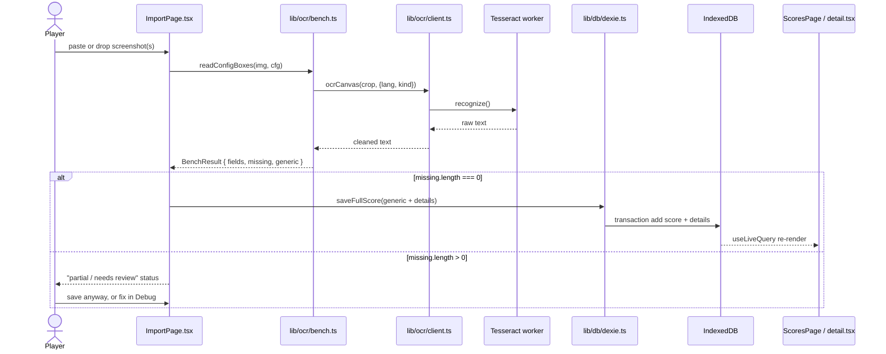
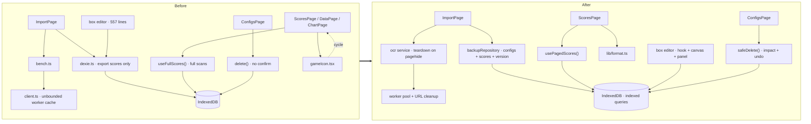

# Software Maintenance Assessment Report

**Software Evolution and Re-engineering · Caraga State University, College of Computing and Information Sciences**

| Field | Value |
|---|---|
| Project/System Title | Ritsu (repository name `ritsu-web`, package name `ritsu-web-app`) |
| Client/Partner Organization | Rhythm Game Players |
| Date of Assessment | 11/13/2026 |
| Repository | `C:\Projects\ritsu-web`, branch `main`, HEAD `64c3a235` |
| Assessment Type | Read-only maintenance audit; no source file was modified |

### Project Development Team

| Name | Role |
|---|---|
| Kent Andres | UI/UX Developer / Project Manager |
| Nash Azarcon | Frontend Developer |
| Kyle Bravo | QA Tester |

> **Evidence convention.** `[FACT]` = directly observed in a file, command output, or commit; `[INFERRED]` = reasoned from named facts; `[TEAM INPUT]` = cannot be established from the repository. Every claim cites `path:line`, a command output ID from `Ritsu_Assessment_Raw_Evidence.md` (R-00…R-25), or a commit hash. Evidence IDs used in Parts II–VII are defined in Section 2.2. The raw command log is the companion file `Ritsu_Assessment_Raw_Evidence.md`.
>
> **Table tagging rule.** Inside tables, the cited evidence ID or `file:line` carries the FACT weight; `[TEAM INPUT]` is written explicitly wherever repository evidence cannot decide a claim, and `[INFERRED]` is written wherever an outcome is projected from a cited baseline (Sections 6.3 and 8.3).

---

## PART I. PROJECT BACKGROUND AND SYSTEM OVERVIEW

### 1.1 Project Description

[FACT] Ritsu is a browser-based, local-first rhythm-game **score tracker** implemented as a React single-page application. Its eight routes are the score library, data dashboard, chart details, game details, config management, OCR box editor, screenshot import, and debug tools (`src/app.tsx:17-24`). [FACT] The repository contains no game loop, audio playback, gameplay input handling, hit judgement, chart parser, or audio/chart assets (E-01; R-13), so Ritsu does not play rhythm games; it records, corrects, and analyzes results produced by other games. [FACT] The README that was deleted in commit `64c3a235` described the project in one line: "A rhythm game stats tracker on web" (`git show 64c3a235 -- README.md`; E-02). [INFERRED] The problem addressed is the manual effort of logging rhythm-game results: players supply a screenshot, OCR reads per-game boxes defined in a JSON config, accuracy and combo are derived when the screenshot lacks them (`src/lib/calc/scoring.ts:7-55`), and records persist in IndexedDB (`src/lib/db/dexie.ts:50-57`). [FACT] Scope is single-device and offline: there is no account, server API, cloud sync, or shared leaderboard; the "Account" icon navigates to the local Data page (`src/components/Layout.tsx:19`; E-23).

### 1.2 Intended Users and Stakeholders

| User/Stakeholders | Role or Interaction with the System |
|---|---|
| Rhythm Game Players | [FACT] Primary end users. They add game configs, import result screenshots (or paste them with Ctrl+V), enter scores manually, search/sort their library, and inspect per-game, per-chart, and period analytics (`src/pages/ScoresPage.tsx:7-30`; `src/pages/ImportPage.tsx:23-25`; `src/pages/DataPage.tsx:245-279`). |
| Players who author game configs ("config authors") | [FACT] A subset of players who create or import a game's JSON config, draw OCR rectangles in the BoxEditor, assign judgment weights, and choose which slots exist (`src/pages/ConfigsPage.tsx:49-61`; `src/pages/BoxEditorPage.tsx:19-22`; `src/lib/config/types.ts:31-47`). |
| Development team (Kent Andres, Nash Azarcon, Kyle Bravo) | [FACT] Maintainers. Git history shows 22 commits by `kentpz727` and 2 by `Nash` (R-05); the current `src/` tree was added by Nash in commit `64c3a235` (E-31). [TEAM INPUT] Kyle Bravo has no commits in the repository; the team must confirm how QA work is recorded. |

### 1.3 Existing System Functionalities

| No. | Module/Feature | Description | Intended User |
|---|---|---|---|
| 1 | Score library, search, filter, sort | Live list of all scores with text search over title/game, game filter, and sort by play time, import time, score, or accuracy (`src/pages/ScoresPage.tsx:18-30`; `src/components/scores.tsx:7-27`). | Rhythm Game Player |
| 2 | Score detail panel and score editing | Right-hand detail card shows rank, accuracy, judgment/metric breakdown, graphs, and opens an edit dialog; edits replace columns and details in one transaction (`src/components/detail.tsx:19-25`; `src/components/EditScore.tsx:9-29`; `src/lib/db/dexie.ts:126-143`). | Rhythm Game Player |
| 3 | Manual score entry | Config-aware form for title, difficulty, score, combo, accuracy, rank, timestamp, and per-game dynamic fields; validates ranges and derives combo/accuracy when boxes are absent (`src/components/ManualEntry.tsx:10-25`; `src/components/useScoreForm.ts:93-195`). | Rhythm Game Player |
| 4 | Screenshot bulk import with OCR | Multi-file import; every box defined by the selected game config is cropped and OCR'd; auto-saves only when no required field is missing, otherwise offers a partial-save review path (`src/pages/ImportPage.tsx:105-177`; `src/lib/ocr/bench.ts:139-180`). | Rhythm Game Player |
| 5 | Clipboard capture | Global Ctrl+V / Print Screen listener publishes image files to the Import page; text inputs are excluded (`src/lib/pasteBus.ts:1-27`; `src/components/Layout.tsx:48-60`). | Rhythm Game Player |
| 6 | OCR box editor | Canvas overlay for dragging, resizing, creating, and deleting normalized OCR boxes per field; numeric x/y/w/h inputs; lock toggle persisted in `localStorage` (`src/pages/BoxEditorPage.tsx:19-22`, `415-431`). | Config author |
| 7 | Game config manager | Create blank config, import JSON file/draft, dedupe field keys, export a config, upload/remove a game logo, and delete a config (`src/pages/ConfigsPage.tsx:17-61`, `67-103`). | Config author |
| 8 | Game dashboard | Per-game best score per chart, ranking value, and up to 10 chart series on a graph (`src/pages/GameDetailsPage.tsx:6-42`). | Rhythm Game Player |
| 9 | Chart dashboard | Per-chart play history, best records sorted by a selected metric, trend graph, and "Chart Leaderboard" (local only) (`src/pages/ChartDetailsPage.tsx:7-52`). | Rhythm Game Player |
| 10 | Data analytics dashboard | Day/week/month/year/range filters, play counts, top songs, top scores weighted by note count, and per-game trend lines (`src/pages/DataPage.tsx:11-230`). | Rhythm Game Player |
| 11 | Backup, restore, export | JSON export/import and CSV export via `downloadFile`; import reports skipped games (`src/lib/db/dexie.ts:223-326`; `src/pages/DataPage.tsx:232-243`). | Rhythm Game Player |
| 12 | Debug tools | OCR bench with Tesseract/Paddle A/B toggle, raw database viewer with delete and repair, and a manual-entry fallback (`src/pages/DebugPage.tsx:4-13`; `src/components/debug.tsx:7-21`). | Development team, config author |
| 13 | PaddleOCR engine (incomplete) | Experimental second OCR engine selected per import/bench; runs on the main thread and downloads PP-OCRv5 models on first use (`src/lib/ocr/paddle.ts:1-27`). | Development team |
| 14 | Data repair | Scans stored scores for non-finite numerics and non-string text and fixes them in place (`src/lib/db/dexie.ts:145-186`). | Rhythm Game Player |

[FACT] No row above implements gameplay, audio, note charts, hit judgement, or online features; those absences are verified in E-01 and E-23.

### 1.4 Technology Stack

| Component | Technology Used |
|---|---|
| Language | TypeScript 6.0.3 (`package-lock.json` resolved; `tsconfig.json:3-13`), TSX for 17 files and TS for 12 files (R-02) |
| UI framework | React 19.3.0 and ReactDOM 19.3.0 (`package-lock.json`; `src/main.tsx:1-9`) |
| Routing | react-router-dom 7.18.4 with `HashRouter` (`src/app.tsx:1`, `14`) |
| Rendering approach | DOM/CSS for application UI; Canvas 2D for the OCR box overlay (`src/pages/BoxEditorPage.tsx:102-133`); inline SVG for graphs (`src/components/detail.tsx:104-140`) |
| Audio library | **None.** No audio API, audio file, or chart file exists (E-01; R-13) |
| Build tool | Vite 8.3.0 with `@vitejs/plugin-react` 6.1.1; build script `tsc && vite build` (`package.json:6-10`; build output in E-03) |
| Package manager | npm 11.19.0, lockfile version 3 (R-00, R-03) |
| Storage | Dexie 4.4.6 over IndexedDB, database name `RitsuDatabase`, schema version 1 (`src/lib/db/dexie.ts:45-58`); `dexie-react-hooks` 4.4.0 for live queries |
| OCR | Tesseract.js 7.0.0 (`src/lib/ocr/client.ts:5`); experimental `@paddleocr/paddleocr-js` 0.4.2 with `onnxruntime-web` 1.30.0 and `@techstark/opencv-js` 4.10.0-release.1 (`src/lib/ocr/paddle.ts:23-27`) |
| Styling | Hand-written CSS, 154 lines, custom properties and one breakpoint (`src/index.css:1-57`); no CSS framework |
| Fonts | Google Fonts Poppins and Zen Maru Gothic loaded at runtime (`index.html:8-13`); no local font files |
| Testing tools | **None.** No test files, no test script, no Vitest/Jest/Playwright/Cypress dependency (E-04) |
| Linting/formatting | **None.** No ESLint/Prettier config and no lint script (E-05) |
| Version control | Git 2.55.0.windows.5; 19 commits on `main`; no tags; `dist/index.html` tracked despite `.gitignore:11` (E-31) |
| CI/CD | **None.** No `.github/workflows`, no other CI config (E-02) |
| Hosting/deployment | NOT FOUND IN CODEBASE – NEEDS TEAM INPUT. No `vercel.json`, `netlify.toml`, Dockerfile, or deploy script exists; `HashRouter` is compatible with static hosting but no target is recorded (`src/app.tsx:14`) |
| Runtime environment | Node.js 24.20.0, npm 11.19.0 (R-00) |

---

## PART II. CURRENT SOFTWARE SYSTEM ASSESSMENT

### 2.1 Software Quality Assessment

| Assessment Area | Current Condition/Observation | Strengths | Weaknesses |
|---|---|---|---|
| Functionality/Correctness | **Fair.** The eight tracker routes implement their stated flows and the build succeeds (`npm run build` exit 0, E-03). Two verified correctness defects exist: export omits configs while import skips scores for absent configs (`src/lib/db/dexie.ts:223-245`, `271-275`; E-11), and all `false` misc values are filtered out of the detail panel (`src/lib/config/types.ts:220`; E-19). | Core flows are complete for a tracker: OCR import, manual entry, edit, analytics, backup (`src/pages/ImportPage.tsx:105-177`; `src/components/useScoreForm.ts:93-195`). | Silent cross-device data loss (P-01) and a display rule that makes "false" indistinguishable from "not recorded" (P-13). No tests verify either path. |
| Reliability | **Fair.** Numeric inputs are coerced at every write (`src/lib/db/dexie.ts:80-95`) and `repairScores()` exists (`dexie.ts:146-186`), but there is no error boundary and 4 `alert()` calls are the only failure surface (E-26). | Defensive numeric layer: `finiteOr()` and `toGraphPoint()` prevent NaN from poisoning SVG polylines (`src/lib/numbers.ts:6-31`). | No React error boundary; a render exception in any route blanks the app (grep for `ErrorBoundary` returned no output; E-26). |
| Performance | **Fair.** Initial JS is 474.00 kB (148.59 kB gzip); the first OCR session can fetch 50.5 MB of worker/WASM chunks (`npm run build`, E-03). Every screen loads all scores, all details, and all configs into memory (`src/lib/db/dexie.ts:98-116`; `src/components/scores.tsx:7-27`; E-20). | PaddleOCR is behind a dynamic import so its SDK stays out of the main chunk (`src/lib/ocr/paddle.ts:3-5`, `23`); Vite reported 82 modules transformed. | No route-level code splitting; no pagination or virtualization on the score list (only the Debug tables slice to 100/200, `src/components/debug.tsx:125-126`). |
| Usability/UX | **Good.** Coherent dark theme, sticky top bar, responsive single-column layout under 1000 px, and a bulk-import status list with per-image messages (`src/index.css:2-57`; `src/pages/ImportPage.tsx:144-173`). | Partial-import path asks before saving incomplete screenshots instead of dropping them (`ImportPage.tsx:144-158`). | "Account" opens `/data` and three screens say "Leaderboard" while showing only local data (`src/components/Layout.tsx:19`; E-24); canvas box editing is pointer-only (E-25). |
| Maintainability | **Fair.** TypeScript `strict` is enabled (`tsconfig.json:14`), and the `lib` layer is split by concern, but `BoxEditorPage.tsx` is 557 lines with 11 `useState` hooks and 20 function declarations (E-10). | Strict typing and a small, readable `src/lib/calc` layer (118 lines, R-02). | 0 tests, 0 lint rules, no README/doc; 146 duplicated lines (2.55%) including an 87-line clone (E-08); one circular dependency (E-09). |
| Modularity/Code Structure | **Good.** Clear three-layer separation: `src/lib` (logic), `src/components` (reusable UI + hooks), `src/pages` (routes), wired in `src/app.tsx:1-26`. | Config-driven field model lets new games be added without code changes (`src/lib/config/types.ts:31-47`, `101-124`; E-29). | `components/scores.tsx` ↔ `components/gameIcon.tsx` cycle (`scores.tsx:4`; `gameIcon.tsx:4`; E-09); analytics rules embedded in `DataPage.tsx:206-230` instead of `lib/calc`. |
| Readability/Documentation | **Poor.** No README, `docs/`, CHANGELOG, architecture note, or data-format spec; README was deleted in `64c3a235` (E-02). | In-file comments explain intent and Android parity decisions (`src/lib/calc/scoring.ts:1-13`; `src/lib/db/dexie.ts:1-2`; `src/lib/ocr/client.ts:1-4`). | A new maintainer cannot learn setup, data model, or OCR box semantics from repository documentation (P-19); `parseGameConfig` semantics are only implicit in code (`src/lib/config/types.ts:79-96`). |
| Testability | **Poor.** 0 test files, no test script, no test framework (E-04). Pure logic is concentrated in testable modules (`src/lib/calc/scoring.ts`, `src/lib/numbers.ts`, `src/lib/config/types.ts`) but has no harness. | Business math is mostly pure functions with explicit inputs (`scoring.ts:14-70`). | OCR, IndexedDB, and React flows have no seams or fixtures; regression safety is manual only. |
| Security | **Fair.** No `innerHTML`, `dangerouslySetInnerHTML`, `eval`, `new Function`, `fetch`, XHR, secrets, or tokens in `src` (R-14). Config JSON is user-supplied and only `gameName` is validated (`src/lib/config/types.ts:79-96`; E-18). `npm audit` reports 3 high advisories (E-06). | Local-only architecture removes server-side attack surface; imports are parsed with `JSON.parse` and string-coerced fields (`dexie.ts:254-289`). | Unvalidated config objects can carry wrong types into render paths (P-03); direct `vite` and `zod` advisories are unresolved (P-06). |
| Compatibility/Portability | **Good.** Uses evergreen browser APIs (IndexedDB, Clipboard API, Pointer Events, Canvas 2D) with no vendor prefixes; `HashRouter` avoids server rewrite requirements (`src/app.tsx:14`; E-30). | Single static bundle can be hosted anywhere that serves files. | Desktop-first: one 1000 px breakpoint and a fixed 416 px bottom nav (`src/index.css:54-57`, `113-125`); no Safari/Firefox test record exists (E-04). |
| Scalability | **Fair.** All list views call `useFullScores()` / `fullScores()` and materialize three tables per consumer (`src/components/scores.tsx:7-27`; `dexie.ts:98-116`; `DataPage.tsx:59`; E-20). | Live queries keep UI consistent without manual cache invalidation (`dexie-react-hooks`). | No pagination, no indexed range queries in the UI, and no benchmark data; cost grows linearly with score count on every route. |
| Dependency Health | **Fair.** All direct dependencies are current major versions (React 19.3.0, Vite 8.3.0, TypeScript 6.0.3, Dexie 4.4.6), but 9 packages are outdated and 3 high advisories are open (`npm outdated`, `npm audit`; E-06, E-07). | Modern, actively maintained stack; zero deprecated APIs detected in `src`. | `papaparse` and `zod` are installed but never imported (E-21); the `zod` advisory is therefore pure risk with no benefit. |
| Accessibility | **Poor.** No `:focus-visible` rule exists; the BoxEditor is operable only by pointer (canvas `onPointerDown/Move/Up/Cancel` at `src/pages/BoxEditorPage.tsx:423-431`); selection feedback lives only inside the canvas as stroke color/width and corner handles (`BoxEditorPage.tsx:116-129`); there is one media query in 154 CSS lines (E-25). | Some forms and images carry labels: `aria-label="Primary"` (`Layout.tsx:28`), alt text on bench/pasted images (`debug.tsx:89`; `ImportPage.tsx:269`), labeled data controls (`DataPage.tsx:249-278`). | Keyboard-only users cannot draw/resize OCR boxes; no skip link; no focus styling; no contrast or assistive-technology test record. |
| Version Control Practice | **Poor.** 19 commits on `main`; 22 of 24 all-branch commits are by one author; the entire 33-file `src/` tree (4,720 insertions) arrived in one commit titled "kapow" (`64c3a235`; E-31). | The working tree is clean after restoring the tracked build artifact, and the earlier `desktop-ui` line was merged (3 merge commits; R-05). | No tags/releases; generic messages ("kapow", "HI"); `dist/index.html` is tracked despite `.gitignore:11` and is modified by every build (E-31). |

### 2.2 Supporting Evidence

| No. | Observation/Issues | Supporting Evidence Explanation |
|---|---|---|
| E-01 | Ritsu has no gameplay layer | `src/app.tsx:17-24` lists eight routes: scores, data, chart, game, configs, editor, import, debug. Searches for `requestAnimationFrame`, `AudioContext`, `new Audio`, `keydown`, `gamepad`, `.osu`, `beatmap`, and `bpm` over `src` returned no output; audio files = 0 and chart files = 0 (R-13). |
| E-02 | No project documentation, licence, or CI | `Test-Path README.md` → False; `LICENSE` → False; `.github` → False; no `docs/`, CHANGELOG, or ESLint/Prettier config (R-04). `git show 64c3a235 -- README.md` shows the only README content deleted: "# ritsu-web / A rhythm game stats tracker on web." |
| E-03 | Build succeeds; bundle is heavy | `npm run build` exit 0: `dist/assets/index-C_3bjGQV.js 474.00 kB │ gzip: 148.59 kB`; `worker-entry 11,341.48 kB`; `ort-wasm…wasm 28,312.02 kB`; `dist-DKOZvoWR.js 10,476.36 kB`; Vite warns "Some chunks are larger than 500 kB" (R-06). OCR-path artifacts sum to ≈50.5 MB. |
| E-04 | Zero automated tests | Recursive search for `*.test.*` / `*.spec.*` under `src` returned no files; `COUNT: 0`; `npm test` → `npm error Missing script: "test"`, exit 1. `package.json:6-10` defines only `dev`, `build`, `preview` (R-07). |
| E-05 | No lint or format gate | `npm run lint` → `npm error Missing script: "lint"`, exit 1; recursive search for eslint / prettier / editorconfig / stylelint returned no files (R-08). |
| E-06 | Three high-severity dependency advisories | `npm audit --json` metadata: `{"high":3,"critical":0,"total":3}` for `source-map-js` (GHSA-68fv-2mgg-jv7q, CVSS 7.5), direct `vite` (six advisories incl. GHSA-698v-4r3x-3vcv), and direct `zod` (GHSA-mrhx-c7xc-m3w5, CVSS 7.5) (R-09). |
| E-07 | Nine packages outdated | `npm outdated` lists `@vitejs/plugin-react` 6.1.1→6.3.0, `dexie` 4.4.6→4.4.7, `papaparse` 5.7.0→5.7.1, `react`/`react-dom` 19.3.0→19.3.1, `react-router-dom` 7.18.4→7.18.5, `typescript` 6.0.3→7.0.2 (major), `vite` 8.3.0→8.3.8, `zod` 4.6.5→4.6.7 (R-10). |
| E-08 | Duplicated form block | `jscpd` found 3 clones, **146 duplicated lines (2.55%)**, including `src/components/EditScore.tsx:58-145` ↔ `src/components/ManualEntry.tsx:50-139` (87 lines, 2,094 tokens) and a 45-line inner clone (R-11). |
| E-09 | One circular dependency | `madge --circular` → "Found 1 circular dependency! 1) components/scores.tsx > components/gameIcon.tsx", exit 1. Imports: `scores.tsx:4` imports `GameIcon`; `gameIcon.tsx:4` imports `initials` (R-11). |
| E-10 | BoxEditor is a god component | `src/pages/BoxEditorPage.tsx` is 557 lines; `useState` appears 11 times and `function` 20 times in the file; the component mixes routing, config parsing, canvas drawing, pointer math, persistence, field CRUD, and JSX (R-19; `BoxEditorPage.tsx:38-133`, `258-321`). |
| E-11 | Backup/restore drops data | `exportToJson()` builds `{exportTimestamp, scores[]}` only (`dexie.ts:223-245`); `importFromJson()` skips any score whose `gameName` has no local config (`dexie.ts:271-275`) and returns `skippedGames` (`dexie.ts:292`); UI says "(skipped unknown games: …) — import their configs first." (`DataPage.tsx:236-239`). |
| E-12 | Config delete is one unconfirmed click | `src/pages/ConfigsPage.tsx:103`: `<button className="btn" onClick={() => c.id && db.game_configs.delete(c.id)}>Delete</button>` — no dialog, no score-count warning, no undo. |
| E-13 | Export leaks an object URL | `src/pages/ConfigsPage.tsx:96-102` creates `URL.createObjectURL(blob)`, assigns it to an anchor, clicks it, and never calls `URL.revokeObjectURL`. |
| E-14 | Config writes on every keystroke | `BoxEditorPage.tsx:302-321` (`updateField`) calls `persist(next)` inside the change path; `persist()` performs `db.game_configs.update(...)` + `JSON.stringify` (`BoxEditorPage.tsx:258-263`). Editing a label therefore issues one IndexedDB write per character. |
| E-15 | Canvas redraws on every render | `src/pages/BoxEditorPage.tsx:102-133` is a `useEffect` with no dependency array and the comment "redraw every render: cheap and always reflects drag state"; it re-reads the image, resets canvas dimensions, and redraws all boxes each time. |
| E-16 | Image object URLs leak on error | `src/lib/ocr/bench.ts:42-52`: `URL.createObjectURL(file)` is revoked only in `img.onload`; `img.onerror = rej` returns without revoking. `BoxEditorPage.tsx:79-84` creates a URL for the editor image and never revokes it. |
| E-17 | OCR workers are never terminated | `src/lib/ocr/client.ts:12-20` caches workers per language in a module `Map` with no eviction; `terminateOcr()` exists at `client.ts:81-84` but has no call site (grep returns only the definition). |
| E-18 | Config JSON is not schema-validated | `src/lib/config/types.ts:79-96`: `JSON.parse(json) as GameConfigData`, only `gameName` is checked; `judgments/metrics/misc` are filtered to entries with a string `key` but field types, rect ranges, weights, and thresholds are not validated. |
| E-19 | False boolean details are hidden | `src/lib/config/types.ts:220`: `out.misc = out.misc.filter((m) => m.value.toLowerCase() === 'true')` — a stored `false` value is removed from the detail panel, so "No" and "not recorded" render identically. |
| E-20 | Every screen scans whole tables | `fullScores()` reads all three tables (`dexie.ts:98-116`); `useFullScores()` repeats the same three `toArray()` calls (`scores.tsx:7-27`); `DataPage.tsx:59` calls it; `ScoresPage.tsx:8`, `ChartDetailsPage.tsx:9`, and `GameDetailsPage.tsx:8` each call it again. |
| E-21 | Unused dependencies and assets | `git grep` for `from 'papaparse'` and `from 'zod'` in `src` returned no imports (R-12). `hero.png`, `typescript.svg`, `vite.svg`, and `public/icons.svg` have no reference in `src` or `index.html` (R-12, R-16). |
| E-22 | Dead exported symbols | `LineChart` (`detail.tsx:104`), `booleanLabels` (`scoring.ts:72`), `terminateOcr` (`client.ts:81`), and `cleanNumericInput` (`useScoreForm.ts:46`) each have only their definition; `tsc --noUnusedLocals --noUnusedParameters` reports TS6133 for `cleanNumericInput` (R-12). |
| E-23 | No backend, account, or sync | Grep for `fetch(`, `XMLHttpRequest`, `axios`, `login`, `signin`, `auth`, `session`, `api/`, `endpoint` in `src` returned no network/auth code. The Account button is `onClick={() => nav('/data')}` (`Layout.tsx:19`); the database is local `IndexedDB` named `RitsuDatabase` (`dexie.ts:51`). |
| E-24 | "Leaderboard" labels describe local lists | `ChartDetailsPage.tsx:52` "<h3>Chart Leaderboard</h3>", `GameDetailsPage.tsx:57` and `DataPage.tsx:331` "<h3>Game Leaderboard</h3>"; all three iterate `useFullScores()` from local IndexedDB only (E-20, E-23). |
| E-25 | Accessibility gaps | Grep for `prefers-reduced-motion` and `focus-visible` in `src` returned no output. `src/index.css` has one `@media` rule at line 54. BoxEditor canvas has only pointer handlers (`BoxEditorPage.tsx:423-431`); selection is encoded by stroke color (`BoxEditorPage.tsx:92`, `118-119`). |
| E-26 | No global error surface or logging | Grep for `ErrorBoundary`, `componentDidCatch`, `window.onerror`, and `unhandledrejection` in `src` returned no output. `console.log/warn/error/debug` returned no output. `alert(` occurs at `ManualEntry.tsx:41` and `BoxEditorPage.tsx:276,312,352` (R-14). There are 13 `try {` blocks (R-14). |
| E-27 | Form validation rules | `useScoreForm.ts:93-195` requires a normalized title, numeric level, digit-containing score/combo, accuracy in `[0,100]` (`useScoreForm.ts:119-126`), letters-only rank, valid timestamp, and numeric dynamic fields (`useScoreForm.ts:139-147`). |
| E-28 | Numeric hardening exists | `finiteOr()` (`numbers.ts:6-9`), graph-point dropping (`numbers.ts:21-31`), transaction + coercion in `saveFullScore()` (`dexie.ts:80-95`), `repairScores()` (`dexie.ts:146-186`), and a divide-by-zero guard in accuracy (`scoring.ts:24`). |
| E-29 | Config-driven field system | `GameConfigData` declares judgments/metrics/misc and seven fixed OCR slots (`types.ts:31-47`); `PRESET_FIELDS`/`GENERIC_SLOTS` define defaults (`types.ts:101-124`); `readConfigBoxes()` OCRs every configured box (`bench.ts:139-342`). |
| E-30 | Hash routing suits static hosting | `src/app.tsx:14` uses `<HashRouter>`; all routes are declared at `app.tsx:17-24`; no server rewrite config exists (E-02). |
| E-31 | Weak commit granularity and repo hygiene | `git rev-list --count HEAD` = 19; `git shortlog -sne --all` = 22 `kentpz727`, 2 `Nash`; `git log --format=%h -- src` = 1 commit; `git show --stat 64c3a235 -- src` = 33 files, 4,720 insertions; `git tag` empty; `.gitignore:11` ignores `dist` but `git ls-files dist` returns `dist/index.html` (R-05). |
| E-32 | Responsive rules are minimal | `src/index.css:52` sets `.split { grid-template-columns: 430px 1px 1fr; }`; `index.css:54-57` collapses to one column below 1000 px; `index.css:113-125` fixes the bottom nav at 416 px width with `max-width: calc(100vw - 32px)` (R-24). |

---

## PART III. IDENTIFICATION OF SOFTWARE PROBLEMS AND MAINTENANCE NEEDS

### 3.1 Identified Software Problems

| No. | Identified Problem | Affected Module/Component | Impact on Users/System | Possible Cause |
|---|---|---|---|---|
| P-01 | JSON backup omits game configs, and restore silently skips every score whose game has no local config | `src/lib/db/dexie.ts` (export/import), `src/pages/DataPage.tsx` | **Critical.** A player who exports on device A and imports on device B loses all scores for every game not manually re-created first; the only feedback is a game-name list, not a per-score recovery path. Portability is a core promise of a "backup" button. Evidence E-11, E-18. | The payload was designed for Android parity around scores only (`dexie.ts:200-221`); configs were never added to the envelope, and import deliberately refuses to stub configs (`dexie.ts:253`). |
| P-02 | Deleting a game config is a single unconfirmed click and leaves its scores orphaned | `src/pages/ConfigsPage.tsx` | **High.** One click removes the OCR boxes, judgment weights, and field definitions for a game. Existing scores remain with `configId` pointing at a missing row and render as game "Unknown" (`dexie.ts:114`); the game disappears from the import config list, editing loses config-aware fields, and detail labels fall back to raw keys because `filterDetailsByConfig()` has no config to map them (`types.ts:204-218`). Recovery requires re-importing the exact config. Evidence E-12, E-11. | Inline destructive handler at `ConfigsPage.tsx:103`; no soft-delete, dependency check, or undo was implemented. |
| P-03 | Game config JSON is accepted without schema validation | `src/lib/config/types.ts`, all config consumers | **High.** `JSON.parse(...) as GameConfigData` plus a `gameName` check (`types.ts:79-96`) allows wrong field types (e.g. `weight: "high"`, `type: "banana"`), out-of-range rects (negative/`>1`), and invalid thresholds to reach `readConfigBoxes()`, canvas math, and DB writes. Failures surface as generic render/runtime errors rather than field-level messages. Evidence E-18, E-29. | The parser was written as a thin port of an Android data class; `zod` is already installed but unused (E-21). |
| P-04 | Zero automated tests and no test runner for the OCR, scoring, and persistence pipeline | Whole repository | **High.** Any change to `calculateAccuracy`, import matching, or Dexie schema has no regression signal; `npm test` does not exist (E-04). The form rules in `useScoreForm.ts:93-195` are likewise unexercised (E-27), and the project already contains a data-loss defect (P-01) that tests would have caught with a two-fixture round trip. Evidence E-04, E-27, E-28. | No test script or dev dependency was added (`package.json:6-29`); QA is manual. |
| P-05 | Keyboard and assistive-technology access is missing | `src/index.css`, `src/pages/BoxEditorPage.tsx`, navigation | **High.** Keyboard-only users cannot create, select, or resize OCR boxes because the canvas exposes pointer handlers only (`BoxEditorPage.tsx:423-431`); selection state is conveyed only inside the canvas through stroke color/width and corner handles (`BoxEditorPage.tsx:116-129`); no `:focus-visible` style or accessibility audit record exists. This excludes keyboard users from the primary config-authoring workflow. Evidence E-25. | Canvas-first editor design (`BoxEditorPage.tsx:19-22`); no accessibility pass or audit record exists. |
| P-06 | Three high-severity dependency advisories and nine outdated packages | `package.json`, `package-lock.json` | **High.** `npm audit` reports high advisories in `source-map-js`, direct `vite`, and direct `zod` (E-06); `vite` advisories include a Windows argument-escaping flaw and a dev-server file-exposure issue. Nine packages are behind, including a TypeScript major (E-07). The app is local-only, which limits exposure, but the build toolchain runs on developer machines. Evidence E-06, E-07. | Versions pinned at the September 2026 snapshot; no Dependabot/Renovate or audit gate exists (E-02). |
| P-07 | Initial bundle is 474.00 kB (148.59 kB gzip) and the OCR path ships ≈50.5 MB of chunks | `vite.config.ts` (no manual chunks), `src/app.tsx` (no lazy routes), `src/lib/ocr/*` | **Medium.** Every route loads the full application chunk; the first OCR session can download a 28.3 MB WASM file, an 11.3 MB worker, and a 10.5 MB OCR bundle (E-03). On metered or mobile connections the import workflow becomes impractically slow. Evidence E-03. | All pages are statically imported in `app.tsx:1-10`; Paddle/OpenCV/ONNX are bundled into OCR-only chunks but the Tesseract worker is large; no size budget is enforced. |
| P-08 | Every view loads all scores, all details, and all configs into memory, repeatedly | `src/lib/db/dexie.ts`, `src/components/scores.tsx`, `src/pages/DataPage.tsx` | **Medium.** `fullScores()` materializes three tables (`dexie.ts:98-116`), and `useFullScores()` repeats the same scan independently for each mounted consumer (`scores.tsx:7-27`; E-20). Route changes re-run the scans; memory and CPU grow linearly with score count, and the score list has no pagination. Evidence E-20. | Convenience-first data access; no repository cache, indexed range query, or virtualized list. |
| P-09 | Re-importing the same screenshots creates duplicate score rows | `src/pages/ImportPage.tsx`, `src/lib/db/dexie.ts` | **Medium.** `saveFullScore()` always calls `generic_scores.add()` (`dexie.ts:82-90`), and the import loop saves every successful image (`ImportPage.tsx:160-172`). Importing a folder twice doubles the library and distorts play counts and analytics. There is no composite uniqueness check on game/song/difficulty/time. Evidence E-11 (data model), E-03 (import path), `dexie.ts:54` (indexes only, not unique). | Import was designed as an append-only capture pipeline; duplicate detection was not specified. |
| P-10 | Structural debt: a 557-line god page plus an 87-line duplicated form block | `src/pages/BoxEditorPage.tsx`, `src/components/EditScore.tsx`, `src/components/ManualEntry.tsx` | **Medium.** `BoxEditorPage.tsx` mixes six responsibilities and 11 state variables (E-10); `EditScore` and `ManualEntry` duplicate 87 lines of markup and validation wiring (E-08), so a validation change must be made twice and can diverge. Both raise the cost of every future change and make unit testing impractical. Evidence E-10, E-08. | Feature growth inside route components without extraction; the edit dialog was copied from the manual-entry form. |
| P-11 | Circular dependency between `scores.tsx` and `gameIcon.tsx` | `src/components/scores.tsx`, `src/components/gameIcon.tsx` | **Medium.** `scores.tsx` imports `GameIcon` (`scores.tsx:4`) and `gameIcon.tsx` imports `initials` (`gameIcon.tsx:4`), reported by `madge` as the only cycle (E-09). The cycle couples list rendering to icon rendering, complicates isolated testing, and can produce undefined imports under different bundler orderings. Evidence E-09. | A small helper (`initials`) was placed in the list component instead of a shared module. |
| P-12 | Object URLs and OCR workers are not consistently released | `src/pages/ConfigsPage.tsx`, `src/lib/ocr/bench.ts`, `src/pages/BoxEditorPage.tsx`, `src/lib/ocr/client.ts` | **Medium.** Config export never revokes its blob URL (`ConfigsPage.tsx:96-102`); image load failure does not revoke (`bench.ts:50`); the editor image URL is never revoked (`BoxEditorPage.tsx:79-84`); Tesseract workers stay alive for the tab lifetime and `terminateOcr()` is uncalled (`client.ts:12-20`, `81-84`). Long sessions accumulate blob memory and up to three OCR workers. Evidence E-13, E-16, E-17. | Cleanup was added only on success paths; no lifecycle owner for OCR resources. |
| P-13 | `false` values in the Misc category are filtered out of the score detail panel | `src/lib/config/types.ts` | **Medium.** `filterDetailsByConfig()` keeps only `value === 'true'` (`types.ts:220`). A score explicitly marked "not full combo" or "not cleared" renders identically to a score where the field was never recorded, which misrepresents results in the detail panel and edit dialog. Evidence E-19. | The filter was written to hide empty checkboxes rather than to render boolean state. |
| P-14 | BoxEditor persists to IndexedDB on every keystroke and redraws the full canvas on every render | `src/pages/BoxEditorPage.tsx` | **Medium.** `updateField()` calls `persist()` inside each change (`BoxEditorPage.tsx:302-321`), so renaming a key issues one read + stringify + update per character (E-14). The redraw effect has no dependency array and resets canvas dimensions each render (`BoxEditorPage.tsx:102-133`; E-15). On large screenshots this produces avoidable main-thread work and write amplification. Evidence E-14, E-15. | Controlled inputs wired directly to persistence; the redraw effect intentionally "runs every render" as a shortcut. |
| P-15 | "Account" and "Leaderboard" labels imply online features that do not exist | `src/components/Layout.tsx`, `src/pages/ChartDetailsPage.tsx`, `src/pages/GameDetailsPage.tsx`, `src/pages/DataPage.tsx` | **Low.** The Account button opens `/data` (`Layout.tsx:19`), and three screens label local, single-device lists as "Leaderboard" (E-24). Players expecting sign-in or shared rankings reach a local analytics page instead; the mismatch weakens trust in the product's scope. Evidence E-23, E-24. | Labels were carried over from the Android UI vocabulary or drafted before the local-only architecture was fixed. |
| P-16 | Failure handling relies on four `alert()` calls with no error boundary or logging | `src/components/ManualEntry.tsx`, `src/pages/BoxEditorPage.tsx`, whole app | **Low.** Any uncaught render error unmounts the React tree (no boundary found; E-26). Background OCR failures are shown inline, but unexpected exceptions are not logged, so the team cannot diagnose a user report. Evidence E-26. | Prototype-stage error handling; no observability requirement was set. |
| P-17 | Dead code, unused dependencies, and unused assets remain in the tree | `src/components/detail.tsx`, `src/lib/calc/scoring.ts`, `src/lib/ocr/client.ts`, `src/components/useScoreForm.ts`, `src/assets/*`, `public/icons.svg`, `package.json` | **Low.** Four exported symbols have no call site (E-22); `papaparse` and `zod` are installed but unimported (E-21); four assets are unreferenced (R-12). This inflates install size and misleads maintainers about what is actually used. Evidence E-21, E-22. | Iterative development without a dead-code check; `noUnusedLocals` is disabled (`tsconfig.json:15-16`). |
| P-18 | No lint, format, or CI gate; unused-local checks are disabled | repository root, `tsconfig.json` | **Low.** `npm run lint` does not exist (E-05); no `.github/workflows` (E-02); `tsconfig.json:15-16` turns off `noUnusedLocals`/`noUnusedParameters`, which is why the `cleanNumericInput` warning only appears with an explicit flag (E-22). Style and dead-code drift therefore reaches `main` unchecked. Evidence E-05, E-02, E-22. | No tooling was added after the Parcel→Vite migration; builds run only locally. |
| P-19 | No README, architecture note, data-format specification, licence, or release tags; whole `src/` landed in one commit | repository root, git history | **Low.** The only README was deleted in `64c3a235` (E-02); there is no document describing the Dexie schema, config JSON, or OCR box semantics. The entire 33-file `src/` tree (4,720 insertions) was added in one commit titled "kapow", and no tag exists (E-31). Onboarding a fourth maintainer or submitting the project for turnover requires re-deriving the design from code. Evidence E-02, E-31. | Solo/small-team prototype workflow; documentation and release discipline were deferred. |

### 3.2 Client Requirements and Requested Improvements

[FACT] The repository contains **no** issue tracker export, `docs/` folder, roadmap, CHANGELOG, feedback file, or TODO/FIXME comment that records a client request. The only documented product statement is the deleted README line "A rhythm game stats tracker on web" (E-02). [FACT] No `TODO`, `FIXME`, `HACK`, `XXX`, or `DEPRECATED` comment exists in `src` (R-14). Consequently, every row below is a **team hypothesis to validate with the client**, not a client statement.

| No. | Client Requirement/Requested Improvement | Reason for Request | Supporting Evidence Explanation |
|---|---|---|---|
| R-01 | A playable rhythm-game mode (game loop, audio sync, note charts, judgement) | [TEAM INPUT] The client is "Rhythm Game Players", but the delivered system only tracks results. The team must ask whether the client expects Ritsu itself to be playable or only to record other games' results. | [FACT] No gameplay code or assets exist (E-01); the README's phrase "rhythm game stats tracker" suggests a tracker, but the client's expectation is unrecorded. Suggested question: "Should Ritsu play charts, or only track scores from other games?" |
| R-02 | One-file backup that restores configs **and** scores | [TEAM INPUT] Current export excludes configs and restore skips scores for absent games, so "backup" does not survive a device change. Validate whether cross-device restore is a required workflow. | [FACT] Export payload contains scores only (`dexie.ts:223-245`) and import skips unknown games (`dexie.ts:271-275`; E-11). Suggested question: "Do you move your library between devices or browsers?" |
| R-03 | Optional account and cloud sync across devices | [TEAM INPUT] Local-only IndexedDB means clearing browser data or changing devices loses the library unless a manual file is kept. Validate whether players want an account or prefer offline-only storage. | [FACT] No auth, API, or sync code exists (E-23); the database is `RitsuDatabase` in IndexedDB (`dexie.ts:51`). Suggested question: "Would you create an account to sync scores, or is local-only preferable?" |
| R-04 | Online or shared leaderboards | [TEAM INPUT] Three screens already use the word "Leaderboard" but rank only the local device's rows. Validate whether players expect comparison with other players. | [FACT] Labels at `ChartDetailsPage.tsx:52`, `GameDetailsPage.tsx:57`, `DataPage.tsx:331` are fed by `useFullScores()` from IndexedDB (E-20, E-24). Suggested question: "Do you expect to compare scores with friends or the wider community?" |
| R-05 | Installable offline app (PWA) or packaged mobile app | [TEAM INPUT] The UI is responsive below 1000 px and has a fixed bottom nav, which suggests phone use, but no manifest, service worker, or mobile package exists. Validate the target platforms and offline expectation. | [FACT] One breakpoint and a fixed bottom nav (`index.css:54-57`, `113-125`; E-32); no `manifest.json` or service worker in the tree (R-01). Suggested question: "Which devices do you use, and must the app work with no connection after first load?" |
| R-06 | Direct import from the Android Ritsu app or other trackers | [TEAM INPUT] The code repeatedly cites Android parity and accepts a legacy flat JSON shape, but no documented migration path or sample file exists. Validate which source apps players actually use. | [FACT] Comments cite Android Room/DataManager parity (`dexie.ts:1-2`, `200-202`); import accepts nested Android shape or flat legacy shape (`dexie.ts:265-270`; E-11). Suggested question: "Which app or spreadsheet holds your scores today?" |
| R-07 | Scheduled or reminder-based backups | [TEAM INPUT] Backup is a manual button with no reminder; players can lose months of data without noticing. Validate whether an automatic reminder or periodic export is desired. | [FACT] Export is invoked only from the Data page (`DataPage.tsx:232-243`; `dexie.ts:223-245`); no timer, notification, or reminder code exists (E-23). Suggested question: "How often would you want to be reminded to back up?" |
| R-08 | Automated regression suite and CI gate before new features | [TEAM INPUT] A quality requirement the team should propose to the client, because every future change currently ships without tests or build verification beyond a local run. | [FACT] 0 tests and no test script (E-04); no CI config (E-02); `dist/index.html` is modified by local builds (E-31). Suggested question: "Would you accept a short stabilization period before new features?" |
| R-09 | Published data-format and config-schema specification | [TEAM INPUT] Config authors and future maintainers need a stable contract for the JSON that drives OCR; none exists. Validate whether third-party config sharing is expected. | [FACT] No docs/README (E-02); the config shape exists only as TypeScript interfaces (`types.ts:31-47`) and a lenient parser (`types.ts:79-96`; E-18, E-29). Suggested question: "Will players share or publish configs for new games?" |

---

## PART IV. SOFTWARE MAINTENANCE CLASSIFICATION

### 4.1 Maintenance Classification Matrix

| No. | Problem/Required Change | Maintenance Type | Justification | Proposed Action |
|---|---|---|---|---|
| P-01 | Backup omits configs; restore skips scores for absent games | Corrective | This is an existing defect in a shipped feature: export→import on a fresh profile loses rows today (E-11). It is not adaptive (no environment change), not perfective (nothing is being enhanced beyond making backup work), and not preventive (the loss is already happening). | Include `gameConfigs[]` and a `schemaVersion` in the export envelope; import configs first, then scores; test a 2-config/10-score round trip. |
| P-02 | One-click config delete orphans scores | Corrective | The destructive path already exists and produces orphaned rows with raw detail labels and an unimportable game (E-12, E-11). Missing confirmation is a defect in the current delete feature, not an enhancement (no environment change, no new capability, no future fault being prevented). | Add an impact dialog ("N scores will become unlinked"), require typed confirmation, and offer undo via a soft-delete flag. |
| P-03 | Config JSON is not schema-validated | Corrective | The input path accepts files today and can inject wrong-typed fields into rendering and OCR (E-18). The defect is present; validation is not a new capability (no version/platform change, no feature addition, no regression tooling). | Validate with a `zod` schema (already a dependency), clamp rects to 0–1, reject unknown types, and return field-level errors. |
| P-04 | Zero automated tests / no test runner | Preventive | Nothing is broken by the absence of tests; the purpose is to prevent future regressions while P-01/P-02/P-03 are fixed. Not corrective (no runtime fault), not perfective (no new user feature), not adaptive (no environment change). | Add Vitest + React Testing Library + `fake-indexeddb`; target scoring, config parsing, export/import, and delete cascade. |
| P-05 | Keyboard access missing | Corrective | Keyboard-only users cannot operate the box editor today (E-25); this is an existing usability fault for a subset of users, not a feature expansion (no environment change, no new feature, no test/tooling change). | Add `:focus-visible`, keyboard nudging/resizing for boxes, non-canvas selection feedback, and an axe/Lighthouse pass. |
| P-06 | 3 high advisories, 9 outdated packages | Adaptive | The environment (npm advisory database and upstream releases) changed after the code was pinned; the system must track patched `vite`, `zod`, and `source-map-js` (E-06, E-07). Not corrective (the app code is not wrong), not perfective (no feature/performance goal), not preventive (the exposure already exists). | Upgrade to patched versions, re-run audit, add a CI audit gate and Dependabot/Renovate. |
| P-07 | 474 kB initial chunk and ≈50.5 MB OCR artifacts | Perfective | The app works; the goal is faster load and lower transfer beyond original requirements (E-03). Not corrective (no failure), not adaptive (no platform change), not preventive (no future fault being avoided). | Lazy-load every route, keep OCR behind dynamic imports, split Paddle/OpenCV/ONNX into an on-demand chunk, and enforce a bundle budget. |
| P-08 | Repeated full-table loads on every route | Perfective | Correct results are produced; the improvement is performance and memory beyond the original implementation (E-20). Not corrective (no wrong output), not adaptive, not preventive (no fault is being prevented). | Introduce a shared score repository/cache, indexed counts, and pagination/virtualization for the list; benchmark 10k rows. |
| P-09 | Re-import duplicates score rows | Corrective | Duplicate rows are an existing data-integrity defect caused by an unconditional `add()` (E-11; `dexie.ts:82-90`). Not perfective (deduplication is expected behavior), not preventive, not adaptive. | Add a uniqueness key (config + song + difficulty + play timestamp) or a pre-insert existence check; report skipped duplicates. |
| P-10 | 557-line god page + 87-line duplicated form | Preventive | Behavior is currently correct; the restructuring is to prevent divergent validation and reduce change cost (E-10, E-08). Not corrective (no defect), not perfective (no user-visible feature), not adaptive. | Extract `useBoxEditor`, `BoxCanvas`, and `FieldPanel`; extract shared `ScoreFormFields` used by EditScore and ManualEntry. |
| P-11 | Circular dependency `scores.tsx` ↔ `gameIcon.tsx` | Preventive | The cycle does not currently produce a visible failure; it is removed to prevent future bundling/test-order faults (E-09). Not corrective, not perfective, not adaptive. | Move `initials()` to `src/lib/format.ts`; import it from both components; add `madge` to CI. |
| P-12 | Object URL and worker leaks | Corrective | Leaks exist on error and success paths today (E-13, E-16, E-17); memory grows within a long session. Not preventive (the fault is present), not perfective, not adaptive. | Revoke URLs in `finally`/`onerror`, terminate workers on `pagehide`, and add cleanup tests. |
| P-13 | `false` misc values are hidden | Corrective | The detail panel misreports stored data today (E-19). Not perfective (this is correctness, not enhancement), not preventive, not adaptive. | Render boolean details as "Yes/No" and keep both values; unit-test `filterDetailsByConfig`. |
| P-14 | Per-keystroke IndexedDB writes and redraw every render | Corrective | The write amplification and full redraw occur on every edit today (E-14, E-15). Not perfective (no new capability), not preventive, not adaptive. | Debounce persistence (~300 ms) and redraw in `requestAnimationFrame` keyed on `img`/`rect`/`cfg`. |
| P-15 | "Account"/"Leaderboard" misleading labels | Perfective | The screens function; the change improves clarity and navigation semantics beyond original requirements (E-24). Not corrective (no data error), not adaptive, not preventive. | Rename to "Local rankings", change Account to "Data", or implement real auth/leaderboards only if R-03/R-04 are confirmed. |
| P-16 | `alert()`-only failures, no boundary or logging | Corrective | Unexpected render errors currently blank the app with no record (E-26). The missing safety net is a present reliability defect. Not perfective (diagnostics are expected behavior), not preventive, not adaptive. | Add a route-level error boundary, toast surface, and `console.error`/telemetry hook with context. |
| P-17 | Dead exports, unused deps/assets | Preventive | Removal does not change behavior; it prevents confusion and future misuse (E-21, E-22). Not corrective (unused code causes no fault), not perfective, not adaptive. | Delete the four dead symbols, remove `papaparse` and unreferenced assets, and use `zod` for P-03 instead of deleting it. |
| P-18 | No lint/format/CI; unused checks disabled | Preventive | The absence of gates does not break the app; gates prevent future drift (E-05, E-02). Not corrective, not perfective, not adaptive. | Add ESLint 9 flat config, Prettier, `tsc --noEmit`, tests, and `npm audit` to a GitHub Actions workflow; enable unused checks. |
| P-19 | No docs/licence/tags; one-shot 4,720-line commit | Preventive | Documentation and release hygiene prevent future onboarding and turnover faults (E-02, E-31). Not corrective (no runtime defect), not perfective, not adaptive. | Write README (setup, architecture, data format, OCR semantics), add LICENSE and CONTRIBUTING, tag `v0.1.0`, untrack `dist/`. |
| R-01 | Playable rhythm-game mode | Perfective | If confirmed, this adds a major new capability beyond the current tracker scope (E-01). Not adaptive (no environment change), not corrective (nothing is broken), not preventive. | Run a discovery spike only after client validation; do not commit gameplay work in the maintenance phase. |
| R-02 | One-file backup including configs | Perfective | Adds a stronger backup capability than the current score-only export (E-11). It overlaps the P-01 fix but is classified separately as a requested product improvement (not corrective because it is framed as an enhancement, not adaptive, not preventive). | Implement together with P-01; expose "Export everything" and "Restore everything" on the Data page. |
| R-03 | Optional account and cloud sync | Perfective | New functionality (authentication, remote storage) beyond original requirements (E-23). Not adaptive (no platform change), not corrective, not preventive. | Defer until client validates; if approved, design a backend with explicit privacy and offline behavior. |
| R-04 | Online/shared leaderboards | Perfective | New social feature beyond the local-only implementation (E-24); not corrective, not adaptive, not preventive. | Defer; if approved, reuse R-03 identity and add server-side ranking with anti-cheat rules. |
| R-05 | Installable PWA / packaged mobile app | Adaptive | Responds to a changed platform expectation (phone use and offline install) rather than a code defect (E-32). Not corrective, not perfective (portability is the driver), not preventive. | Add `manifest.json`, service worker caching, install prompt, and a mobile viewport test matrix. |
| R-06 | Import from Android Ritsu or other trackers | Perfective | Extends interoperability beyond the current JSON shapes (E-11); not corrective, not adaptive, not preventive. | Publish a format spec and add adapters with fixture-based tests. |
| R-07 | Scheduled/reminder-based backups | Perfective | Adds automation beyond the manual export button (E-11); not corrective, not adaptive, not preventive. | Add an opt-in reminder cadence; reuse the P-01 export envelope. |
| R-08 | Automated regression suite and CI gate | Preventive | Quality infrastructure to prevent future defects; behavior is unchanged (E-04, E-02). Not corrective (nothing is broken now), not adaptive (no environment change), not perfective (no user-facing feature). | Same deliverable as P-04/P-18; track coverage and gate merges. |
| R-09 | Published data-format/config-schema spec | Preventive | Documentation prevents incompatible configs and future integration faults (E-02, E-18). Not corrective (no runtime fault), not adaptive (no environment change), not perfective (no new capability). | Publish JSON Schema plus examples; version the config format and export envelope. |

### 4.2 Maintenance Strategy Analysis

**Which identified problem requires corrective maintenance?** Nine problems are corrective because the defect exists in the running system, not in a future scenario. P-01 is the most severe: `exportToJson()` never serializes `game_configs` (`src/lib/db/dexie.ts:223-245`), while `importFromJson()` skips any score whose game has no local config (`dexie.ts:271-275`), so a backup restored on a fresh browser loses all rows for games the user has not manually re-created (E-11). P-02 is corrective because the delete handler at `src/pages/ConfigsPage.tsx:103` already creates orphaned rows and strips the config-aware labels and fields for that game, leaving raw detail keys via the no-config branch of `filterDetailsByConfig()` (`types.ts:215-218`). P-03 is corrective because an invalid config file can enter the system today and reach OCR and canvas code without a type check (`types.ts:79-96`). P-09, P-12, P-13, P-14, P-05, and P-16 are likewise present-behavior faults: duplicate inserts (`dexie.ts:82-90`), unreleased object URLs/workers (E-13, E-16, E-17), suppressed `false` values (`types.ts:220`), per-keystroke writes (`BoxEditorPage.tsx:302-321`), pointer-only box editing (E-25), and the absence of an error boundary (E-26). Corrective work must come first because every later refactor otherwise risks changing undefined behavior.

**Which problem requires adaptive maintenance?** P-06 is the only adaptive item. The application code has not changed since September 2026, but the environment has: `npm audit` now reports three high advisories in `source-map-js`, `vite`, and `zod` (E-06), and `npm outdated` reports nine newer releases, including TypeScript 7.0.2 against the pinned 6.0.3 (E-07). Adaptive maintenance is required to keep the build toolchain supported and to absorb upstream API/deprecation changes; this is not a code defect (corrective), not a feature (perfective), and not merely future-proofing (preventive) because the vulnerable versions are installed now. R-05 (installable PWA/mobile packaging) is the only adaptive requirement, because it responds to a platform/usage expectation rather than to a broken behavior; it stays deferred until the client confirms the target devices.

**What environmental change must the system accommodate?** The system must accommodate three changes. First, the dependency/security environment: patched `vite` 8.3.8, `zod` 4.6.7, and `source-map-js` ≥1.2.2 exist and the current pins are flagged (E-06, E-07). Second, the browser/storage environment: Ritsu depends entirely on IndexedDB (`dexie.ts:50-57`), so browser storage eviction, private-mode quotas, and origin changes (for example, hosting the same build under a different domain) can erase or strand the library; `HashRouter` (`app.tsx:14`) avoids server rewrites but does not protect storage. Third, the device environment implied by the responsive CSS: a single 1000 px breakpoint and a fixed bottom nav (`index.css:54-57`, `113-125`) suggest phone use, yet no manifest, service worker, or mobile test record exists (E-32, E-04). Adaptive work must also track the OCR model hosting used by PaddleOCR on first run (`src/lib/ocr/paddle.ts:3-7`), because that path depends on remote model availability after deployment.

**What functionality or performance improvements should be introduced through perfective maintenance?** Three problems and six requirements are perfective. P-07 targets load performance: the initial chunk is 474.00 kB (148.59 kB gzip) and the OCR path ships ≈50.5 MB (E-03), so route-level lazy loading and an on-demand Paddle chunk would materially reduce time-to-interactive. P-08 targets data-access performance: every route re-reads all three tables (E-20), so a shared repository plus pagination/virtualization would keep the UI responsive as the library grows. P-15 improves navigation semantics by renaming local "Leaderboard" views and the misleading "Account" button (E-24). The perfective requirements are R-01 (playable mode, only if the client confirms the scope change), R-02 (one-file backup), R-03 (optional account/cloud sync), R-04 (shared leaderboards), R-06 (Android/third-party import), and R-07 (backup reminders). None of these should displace the corrective work; they are sequenced after the data-integrity fixes because they either depend on the new export envelope (R-02, R-06, R-07) or require a backend that does not exist (R-03, R-04).

**What preventive maintenance activities can reduce future problems?** Six problems and two requirements are preventive. P-04 adds the missing test harness so that scoring, config parsing, import/export, and delete cascades gain regression coverage (E-04). P-10 reduces structural risk by splitting the 557-line `BoxEditorPage.tsx` and extracting the 87-line duplicated form block (`E-10`, `E-08`), so future validation changes happen in one place. P-11 removes the only circular dependency (`E-09`), which keeps module boundaries testable. P-17 deletes four dead exports, two unused dependencies, and four unused assets (`E-21`, `E-22`), reducing the surface a maintainer must reason about. P-18 adds linting, formatting, a CI build/test/audit gate, and re-enables unused-local checks (`E-05`, `E-02`, `E-22`). P-19 writes the README, architecture/data-format documentation, licence, and release tags, and untracks `dist/` (`E-02`, `E-31`). R-08 (regression suite + CI) and R-09 (published schema) are the preventive requirements that institutionalize the same controls for the client.

---

## PART V. REVERSE ENGINEERING AND RE-ENGINEERING ASSESSMENT

### 5.1 Reverse Engineering Assessment

| Assessment Question | Yes/No/Partially | Explanation/Evidence |
|---|---|---|
| Is documentation (README/architecture/API docs) complete and current? | No | README was deleted in `64c3a235`; no `docs/`, CHANGELOG, architecture note, or API doc exists (E-02; R-04). The only product sentence in history is "A rhythm game stats tracker on web." |
| Can a new developer understand the architecture from existing artifacts? | Partially | Folder structure is clear (`src/lib`, `src/components`, `src/pages`) and in-file comments explain Android parity (R-01; `dexie.ts:1-2`; `scoring.ts:1-13`), but there is no entry document, no data-flow diagram, and `BoxEditorPage.tsx` mixes six responsibilities (E-10). A newcomer can read the code but cannot learn setup, storage semantics, or OCR box conventions without inference. |
| Do design artifacts (ERD, UML, diagrams) exist? | No | No `.puml`, `.drawio`, `.mmd`, image diagram, or design document is tracked (R-01). The data model exists only as TypeScript interfaces and Dexie index strings (`dexie.ts:16-57`). |
| Is source code available and buildable? | Yes | All 33 `src` files are present; `npm run build` (`tsc && vite build`) exits 0 and produces a 474.00 kB entry chunk (E-03; R-06). `npx tsc --noEmit --noUnusedLocals --noUnusedParameters` reports only one unused local (E-22). |
| Is the data model/chart format documented? | No | Dexie tables and indexes are declared at `src/lib/db/dexie.ts:52-56` with no external schema document. The game-config JSON is defined only by `GameConfigData` (`types.ts:31-47`) and a lenient parser (`types.ts:79-96`). There is no chart/beatmap format at all because gameplay does not exist (E-01). |
| Are there undocumented modules? | Yes | The entire OCR pipeline (757 lines across `src/lib/ocr/*`, R-02) has no external documentation; the PaddleOCR pilot is explicitly labelled a spike with main-thread execution and a worker follow-up (`paddle.ts:1-7`). `repairScores()` (`dexie.ts:145-186`) and the legacy-flat import shape (`dexie.ts:265-270`) are also undocumented outside code comments. |
| **Does your project require reverse engineering?** | **Partially** | Yes for semantics, no for code recovery. The source is complete, typed, and buildable (E-03), so classic reverse engineering to recover lost design is unnecessary. However, the team must reverse-engineer three undocumented contracts before changing anything: the config JSON semantics and optional fields (`types.ts:31-96`), the Dexie schema/index behavior including the composite index (`dexie.ts:52-56`), and the OCR field/heuristic pipeline (`bench.ts:139-342`; `client.ts:1-84`). A one-to-two-day documentation pass over those three areas—captured as R-09 and P-19—is sufficient. A full architectural reverse-engineering effort is not justified. |

### 5.2 Re-engineering Assessment

| Assessment Question | Yes/No/Partially | Explanation/Evidence |
|---|---|---|
| Is the code structure hard to change (high coupling, god files, global state)? | Partially | `BoxEditorPage.tsx` is a 557-line god component with 11 state hooks and 20 functions (E-10); `scores.tsx` ↔ `gameIcon.tsx` form a cycle (E-09); the same 87-line form block is copied in two components (E-08). Outside those hotspots, modules are small: `src/lib/calc` is 118 lines and `src/lib/numbers.ts` is 31 lines (R-02). |
| Is logic separated from UI/rendering? | Partially | OCR, scoring, dates, config parsing, and persistence live in `src/lib` and are imported by components (E-29; `scoring.ts:14-70`; `dexie.ts:64-186`). But analytics rules are embedded in `DataPage.tsx:206-230`, chart grouping in `GameDetailsPage.tsx:11-42`, and form rules in `useScoreForm.ts` (a hook, not `lib`). |
| Is the technology stack outdated/unsupported? | No | Direct dependencies are current majors: React 19.3.0, Vite 8.3.0, TypeScript 6.0.3, Dexie 4.4.6, react-router-dom 7.18.4 (R-03). The problem is patch-level drift and three high advisories (E-06, E-07), not an unsupported stack. |
| Can the codebase be extended (new chart types, new modes) without editing many files? | Partially | New **games and metrics** are config-driven and require no code change (`types.ts:31-47`, `101-124`; E-29). A new **route or mode** requires edits to `app.tsx:1-24`, `Layout.tsx` navigation, and a new page, plus shared data-access changes if it needs scores. Gameplay cannot be added incrementally because no timing/audio/render layer exists (E-01). |
| Is there automated test coverage enabling safe refactoring? | No | 0 test files, no test script, no framework (E-04). Refactoring P-10/P-11 currently relies on manual clicking, and the import/export path has no fixture test despite P-01. |
| Is the performance or timing accuracy architecturally limited? | Partially | There is no gameplay timing, so rhythm timing accuracy is not an architectural property of this codebase (E-01). Tracker performance is limited by full-table reads (E-20) and the 50.5 MB OCR path (E-03), both fixable without a rewrite: lazy routes, indexed queries, and pagination. |
| Would incremental refactoring suffice versus a rewrite? | Yes | The codebase is 4,818 source lines, strictly typed, and builds cleanly (R-02; E-03). The defects are localized: one data envelope (P-01), one delete handler (P-02), one parser (P-03), one god page (P-10), one cycle (P-11), and resource cleanup (P-12). Rewriting would discard working OCR heuristics, config semantics, and Android-parity import logic. |
| **Does your project require re-engineering?** | **Yes (partial)** | Ritsu requires **partial re-engineering**, not a rewrite. The evidence supports four targeted efforts: (1) re-engineer the backup/restore contract so configs and scores travel together and imports are idempotent (P-01, P-09); (2) re-engineer the BoxEditor into a hook + canvas + panel structure and extract the shared score form (P-10); (3) re-engineer data access to a shared repository with indexed/paged queries (P-08); and (4) re-engineer the build/runtime boundary with lazy routes, cleanup owners for OCR resources, and a test/CI gate (P-07, P-12, P-04, P-18). The stack itself is current (R-03), so replacing React, Vite, or Dexie would add risk without addressing any identified defect. A full rewrite is **not** justified. |

### 5.3 Proposed Re-engineering Activities

| No | Proposed Activity | Existing Problem Addressed | Expected Improvement |
|---|---|---|---|
| A-01 | Versioned export envelope with `gameConfigs[]` + `schemaVersion`; import configs before scores; accept legacy shapes | P-01 | A 2-config/10-score fixture round-trips into an empty profile with `imported=10, skipped=0`; current behavior loses all 10 (E-11). |
| A-02 | Two-step delete with impact count, typed confirmation, and soft-delete/undo | P-02 | Delete-cascade test: 5 scores under a config → 0 orphan rows after undo, 5 explicitly unlinked rows after confirmed delete; currently 5 silent orphans (`dexie.ts:114`). |
| A-03 | `zod` schema for `GameConfigData`; clamp rects, validate weights/types; field-level errors | P-03 | A 20-case malformed-config corpus yields 20 caught errors and 0 uncaught exceptions; currently any of them can reach render/OCR code (`types.ts:79-96`). |
| A-04 | Add Vitest + React Testing Library + `fake-indexeddb`; seed tests for scoring, config, export/import, delete cascade | P-04 | Test count 0 → ≥30; line coverage of `src/lib` ≥60% (118 + 222 + 336 lines are the primary targets). |
| A-05 | Accessibility pass: focus-visible, reduced-motion, keyboard box move/resize, text/non-color selection cue, contrast check | P-05 | `prefers-reduced-motion` rules 0 → ≥1; `:focus-visible` rules 0 → ≥1; every BoxEditor operation reachable by keyboard; Lighthouse accessibility score target ≥90. |
| A-06 | Upgrade `vite`→8.3.8, `zod`→4.6.7, `source-map-js`→≥1.2.2; re-audit; add dependency gate | P-06 | `npm audit` high advisories 3 → 0; outdated packages 9 → ≤2 (TypeScript major deferred). |
| A-07 | Route-level `React.lazy` + `Suspense`; keep Paddle/ONNX/OpenCV in an on-demand chunk; define a size budget | P-07 | Entry chunk 474.00 kB (148.59 gzip) → ≤250 kB (≤80 gzip); no route downloads OCR chunks until Import/Debug opens. |
| A-08 | Shared repository/cache for scores; indexed aggregate queries; pagination or virtualization for the score list | P-08 | Full-table scans per navigation 3 → 1 cached load; 10,000-row fixture first render target <100 ms (baseline not measured; record it in Week 5). |
| A-09 | Duplicate detection before insert (composite game/song/difficulty/playTimestamp check or unique index), with a reported skip count | P-09 | Importing the same 10-image folder twice yields 10 rows, not 20; report shows `duplicates=10`. |
| A-10 | Split `BoxEditorPage` into `useBoxEditor`, `BoxCanvas`, `FieldPanel`; extract `ScoreFormFields` shared by EditScore/ManualEntry | P-10 | `BoxEditorPage.tsx` 557 → ≤250 lines; duplicated lines 146 (2.55%) → <50 (<1%); one validation source for both forms. |
| A-11 | Move `initials()` to `src/lib/format.ts`; remove both cross-imports; add `madge` check | P-11 | Circular dependencies 1 → 0; `madge --circular` exits 0 in CI. |
| A-12 | Centralize URL/worker lifecycle: revoke in `finally`/`onerror`, terminate workers on `pagehide`, add cleanup tests | P-12 | Object URLs leaked per failed image 1 → 0; Tesseract workers after tab close ≤0; `terminateOcr()` gains a call site. |
| A-13 | Render boolean details as explicit "Yes"/"No"; keep `false` rows; remove the `=== 'true'` filter | P-13 | A score with `fullCombo=false` shows "No"; a missing value shows "—"; unit test covers both. |
| A-14 | Debounce editor persistence (~300 ms) and move canvas redraw into `requestAnimationFrame` keyed on image/rect/config | P-14 | IndexedDB writes per 10-character rename 10 → 1; canvas draws per render ≤1/frame; `requestAnimationFrame` usage 0 → 1 in the editor only. |
| A-15 | Rename local "Leaderboard" headings and the "Account" button to match actual behavior | P-15 | 5-user UAT: ≥4/5 correctly identify the screen as local-only; 0 labels imply sign-in/shared ranking. |
| A-16 | Route-level error boundary + toast surface + `console.error` with route/context; remove `alert()` calls | P-16 | `alert()` call sites 4 → 0; every one of the 13 `try` blocks surfaces a message; unexpected render error keeps navigation usable. |
| A-17 | Delete dead exports, `papaparse`, and 4 unreferenced assets; repurpose `zod` in A-03 | P-17 | Unused dependencies 2 → 0; unreferenced assets 4 → 0; dead exported symbols 4 → 0. |
| A-18 | ESLint 9 flat config + Prettier + GitHub Actions (`tsc`, tests, lint, audit); enable unused-local checks | P-18 | CI checks 0 → 4; `tsc` with unused checks exits 0 after P-17; every push gated. |
| A-19 | README (setup, architecture, data/config format, OCR semantics), LICENSE, CONTRIBUTING, `v0.1.0` tag, untrack `dist/` | P-19 | Onboarding doc exists; release tags 0 → ≥1; tracked build artifacts 1 → 0; new developer setup path documented in one file. |

---

## PART VI. PROPOSED SOFTWARE EVOLUTION AND IMPROVEMENT PLAN

### 6.1 Proposed Improvement Plan

Each row inherits the evidence cited for its P-xx/R-xx definition in Sections 3.1 and 3.2; the evidence IDs are not repeated here.

| No. | Identified Problem | Proposed Solution/Modification Strategy |
|---|---|---|
| P-01 | Backup/restore data loss | Extend `ExportPayload` with `schemaVersion` and `gameConfigs[]`; import configs first, map scores by `gameName`, keep legacy flat/nested compatibility, and return a per-score failure report (A-01). |
| P-02 | Unconfirmed config delete | Add an impact dialog that counts linked scores, require confirmation, and implement soft-delete with an undo window (A-02). |
| P-03 | Unvalidated config JSON | Introduce a `zod` schema for configs, clamp rects to `[0,1]`, validate weights/thresholds/types, and show field-level errors in ConfigsPage/BoxEditor (A-03). |
| P-04 | Zero tests | Add Vitest + RTL + `fake-indexeddb`; start with scoring, config parsing, export/import round trip, and delete cascade (A-04, R-08). |
| P-05 | Accessibility gaps | Add focus-visible styles, reduced-motion handling, keyboard box editing, and non-color selection cues; run axe/Lighthouse (A-05). |
| P-06 | Vulnerable/outdated deps | Upgrade patched versions, re-run audit, and add Dependabot/Renovate plus an audit CI job (A-06). |
| P-07 | Heavy bundle/OCR payload | Lazy-load routes, keep OCR chunks on demand, and enforce a bundle-size budget in CI (A-07). |
| P-08 | Full-table scans | Add a shared score repository/cache, indexed aggregates, and pagination/virtualization (A-08). |
| P-09 | Duplicate imports | Add duplicate detection and a reported skip count; make import idempotent (A-09). |
| P-10 | God page + duplicated form | Split the editor into hook/canvas/panel and extract shared form fields (A-10). |
| P-11 | Circular dependency | Move `initials()` to `lib/format.ts` and add `madge` to CI (A-11). |
| P-12 | Resource leaks | Centralize URL revocation and worker teardown; add lifecycle tests (A-12). |
| P-13 | Hidden `false` values | Render explicit Yes/No and remove the true-only filter (A-13). |
| P-14 | Per-keystroke writes/redraw | Debounce persistence and redraw via `requestAnimationFrame` (A-14). |
| P-15 | Misleading labels | Rename local rankings and the Account button; implement real online features only if R-03/R-04 are confirmed (A-15). |
| P-16 | No error boundary/logging | Add an error boundary, toast surface, and contextual logging (A-16). |
| P-17 | Dead code/deps/assets | Remove dead symbols, `papaparse`, and unused assets; use `zod` for P-03 (A-17). |
| P-18 | No lint/CI gate | Add ESLint/Prettier and a GitHub Actions pipeline; enable unused-local checks (A-18). |
| P-19 | No docs/tags/licence | Write README plus data-format/architecture notes, add LICENSE, tag `v0.1.0`, untrack `dist/` (A-19). |
| R-01 | Playable gameplay mode | Defer pending client validation; if confirmed, run a time-boxed discovery spike for audio clock, input, and chart format, then plan as a separate product phase. |
| R-02 | One-file backup | Deliver with P-01/A-01 as "Export everything / Restore everything" on the Data page. |
| R-03 | Account/cloud sync | Defer; requires backend design, privacy policy, and offline conflict rules. Record the decision in the README. |
| R-04 | Shared leaderboards | Defer behind R-03; if approved, add server rankings with explicit anti-cheat and privacy rules. |
| R-05 | PWA/mobile packaging | Add manifest, service worker, install flow, and a device matrix; keep IndexedDB as the source of truth. |
| R-06 | Android/third-party import | Publish the format spec (R-09) and add fixture-tested adapters for Android nested and legacy flat shapes. |
| R-07 | Backup reminders | Add an opt-in reminder with configurable cadence, reusing the A-01 export envelope. |
| R-08 | Regression suite + CI gate | Same deliverable as A-04/A-18; report coverage and block merges on failure. |
| R-09 | Published data/config spec | Publish JSON Schema plus examples, version both config and export envelopes, and link from README. |

### 6.2 Implementation Plan

All dates are **[PROPOSED]** and counted from the assessment date 11/13/2026. Work is sequenced so tests and schema validation land before behavior changes, and so bulk refactors happen after the data contract is stable.

| Proposed Improvement | Activities/Tasks | Responsible Member | Target Completion | Expected Output |
|---|---|---|---|---|
| Test harness and fixtures (P-04, R-08) | Add Vitest/RTL/`fake-indexeddb`; create score/config/export fixtures; write first 15 tests for scoring and dates | Kyle Bravo (lead) + Nash Azarcon (support) | Week 1: 11/16–11/22/2026 [PROPOSED] | `npm test` exists; ≥15 passing tests; CI-ready script |
| Config schema validation (P-03, R-09) | Define `zod` schema; wire into ConfigsPage import, BoxEditor save, and import path; add malformed-config corpus | Nash Azarcon (lead) + Kyle Bravo (support) | Week 1: 11/16–11/22/2026 [PROPOSED] | Invalid configs rejected with field-level messages; 20-case test set |
| Backup/restore contract (P-01, P-09, R-02, R-06) | Add `schemaVersion` + `gameConfigs[]`; import configs before scores; add duplicate detection; keep legacy shapes | Nash Azarcon (lead) + Kyle Bravo (support) | Week 2: 11/23–11/29/2026 [PROPOSED] | Empty-profile round trip imports 10/10 scores and 2/2 configs; double import adds 0 rows |
| Safe delete and undo (P-02) | Impact-count dialog; typed confirmation; soft-delete flag; undo toast | Nash Azarcon (lead) + Kent Andres (UX copy) | Week 2: 11/23–11/29/2026 [PROPOSED] | Delete flow warns with score count; undo restores config and links |
| Accessibility pass (P-05) | Focus-visible CSS, reduced-motion query, keyboard box nudge/resize, non-color selection cue, contrast check | Kent Andres (lead) + Nash Azarcon (support) | Week 3: 11/30–12/06/2026 [PROPOSED] | Keyboard-only box edit demo; axe/Lighthouse report ≥90 |
| Error boundary and notifications (P-16) | Route-level boundary, toast component, contextual `console.error`, replace 4 `alert()` calls | Nash Azarcon (lead) + Kyle Bravo (support) | Week 3: 11/30–12/06/2026 [PROPOSED] | No blank-screen failure; all failure paths visible and logged |
| Boolean detail correctness (P-13) and editor writes (P-14) | Render Yes/No; remove true-only filter; debounce persistence; rAF redraw | Nash Azarcon (lead) + Kyle Bravo (support) | Week 4: 12/07–12/13/2026 [PROPOSED] | `false` renders "No"; writes per rename 10 → 1; draw ≤1/frame |
| BoxEditor split + shared form (P-10, P-11) | Extract `useBoxEditor`, `BoxCanvas`, `FieldPanel`, `ScoreFormFields`; move `initials()`; add madge | Nash Azarcon (lead) + Kyle Bravo (support) | Week 5: 12/14–12/20/2026 [PROPOSED] | BoxEditor ≤250 lines; duplication <1%; 0 cycles |
| Data access re-engineering (P-08) | Repository/cache, indexed counts, pagination/virtualization; benchmark 10k rows | Nash Azarcon (lead) + Kyle Bravo (benchmark support) | Week 5: 12/14–12/20/2026 [PROPOSED] | One cached load per navigation; 10k-row benchmark recorded |
| Bundle and asset budget (P-07, P-12) | Lazy routes; on-demand OCR chunk; URL/worker cleanup; size budget check | Nash Azarcon (lead) + Kyle Bravo (verification) | Week 6: 12/21–12/27/2026 [PROPOSED] | Entry ≤250 kB / ≤80 kB gzip; leak checklist passes |
| Dependency upgrades (P-06) | Upgrade vite/zod/source-map-js; re-run audit/outdated; add Dependabot/Renovate | Nash Azarcon (lead) + Kyle Bravo (re-test) | Week 6: 12/21–12/27/2026 [PROPOSED] | 0 high advisories; ≤2 outdated packages |
| Lint, CI, and dead-code cleanup (P-17, P-18) | ESLint/Prettier; GitHub Actions; enable unused checks; delete dead symbols/deps/assets | Nash Azarcon (lead) + Kyle Bravo (CI support) | Week 7: 12/28/2026–01/03/2027 [PROPOSED] | 4 CI checks green; unused checks on; dead code removed |
| Documentation and release (P-19, P-15) | README, architecture/data-format docs, LICENSE, CONTRIBUTING, label rename, tag `v0.1.0`, untrack `dist/` | Kent Andres (lead) + Nash Azarcon (technical review) | Week 7: 12/28/2026–01/03/2027 [PROPOSED] | Onboarding doc, licence, tag, clean artifact policy |
| UAT with Rhythm Game Players (R-01, R-03, R-04, R-05, R-07) | 5-player usability session; validate scope questions; decide defer/implement for gameplay, sync, leaderboards, PWA, reminders | Kent Andres (lead) + Kyle Bravo (protocol) | Week 8: 01/04–01/10/2027 [PROPOSED] | Signed feedback summary; go/no-go decision per requirement |

### 6.3 Expected Improvements

| Quality Attribute | Expected Improvement/Measurable Result |
|---|---|
| Data integrity | Backup round trip: currently 10/10 scores lost when configs are absent (E-11) → 10/10 scores and 2/2 configs restored; duplicate re-import 20 rows for 10 images → 10 rows (P-01, P-09). |
| Correctness of analytics | Play counts and top-score rankings currently inflate on re-import (P-09) → unchanged after duplicate import; `false` boolean details currently invisible (E-19) → explicit "No" for 100% of stored false values (P-13). |
| Reliability | Uncaught render error currently blanks the app (E-26) → error boundary keeps navigation usable and logs context; `alert()` call sites 4 → 0 (P-16). |
| Performance (load) | Entry chunk 474.00 kB / 148.59 kB gzip (E-03) → ≤250 kB / ≤80 kB gzip; first OCR transfer ≈50.5 MB → OCR chunks load only when Import/Debug opens (P-07). |
| Performance (data access) | 3 full-table reads per score view (E-20) → 1 cached load per navigation; 10,000-row benchmark target <100 ms after pagination (P-08). |
| Test coverage | 0 test files and no test script (E-04) → ≥30 tests, ≥60% line coverage of `src/lib` (P-04, R-08). |
| Maintainability | `BoxEditorPage.tsx` 557 lines (E-10) → ≤250 lines; duplicated lines 146 / 2.55% (E-08) → <50 / <1%; circular dependencies 1 → 0 (P-10, P-11). |
| Accessibility | 0 `:focus-visible` rules and 0 keyboard handlers on the editor canvas (E-25) → ≥1 focus-visible rule and every box-editor action keyboard-reachable; Lighthouse accessibility ≥90 (P-05). |
| Security/dependency health | 3 high advisories and 9 outdated packages (E-06, E-07) → 0 high advisories and ≤2 outdated (TypeScript major deferred); CI audit gate on every push (P-06, P-18). |
| Resource usage | Unrevoked object URL on every failed image load and config export (E-13, E-16) → 0 leaked URLs; 3 cached Tesseract workers never terminated (E-17) → workers terminated on `pagehide` (P-12). |
| Developer onboarding | 0 README/docs (E-02) → README + architecture + data/config spec + LICENSE; setup documented end to end (P-19, R-09). |
| Change safety | 0 CI checks (E-02) → 4 checks (`tsc`, tests, lint, audit) blocking merges (P-18, R-08). |
| Code surface | 4 dead exports, 2 unused deps, 4 unused assets (E-21, E-22) → 0 each (P-17). |
| Release traceability | 0 tags and 1 tracked build artifact (E-31) → ≥1 tag (`v0.1.0`) and 0 tracked build artifacts (P-19). |

---

## PART VII. VALIDATION AND TESTING PLAN

### 7.1 Proposed Validation Activities

| No | Proposed Improvement | Validation/Testing Method | Expected Result | Business indicator |
|---|---|---|---|---|
| V-01 | P-01 backup/restore fix | Fixture test: 2 configs + 10 scores → export → clear IndexedDB in a fresh browser profile → import; assert counts and field values. Also test legacy flat and Android nested payloads. | 10/10 scores and 2/2 configs restored; `skipped=0`; field-level values identical. | A player can move devices without losing a single logged play. |
| V-02 | P-02 safe delete/undo | Integration test with 5 linked scores; delete config; assert warning count, orphan state, then undo; assert links restored. | Warning shows "5 scores"; confirmed delete unlinks exactly 5; undo restores 5 links. | No accidental loss of a game's history after a mis-click. |
| V-03 | P-03 config schema | Table-driven test over 20 malformed configs (wrong types, rects <0/>1, missing keys, duplicate keys); assert field-level errors and no uncaught exception. | 20/20 rejected or clamped with messages; 0 uncaught exceptions. | Config authors can fix their JSON without developer help. |
| V-04 | P-04 test harness | Run `npm test -- --coverage`; enforce thresholds in CI. Review tests for scoring, config, dates, export/import, delete cascade. | ≥30 tests pass; ≥60% line coverage in `src/lib`; 0 skipped tests. | Regressions are caught before players see them. |
| V-05 | P-05 accessibility | Keyboard-only script for every screen; axe-core/Lighthouse audit; grayscale and reduced-motion checks. | All BoxEditor actions keyboard-reachable; Lighthouse accessibility ≥90; 0 critical axe violations. | Keyboard and low-vision players can author configs. |
| V-06 | P-06 dependency upgrade | `npm audit --audit-level=high` and `npm outdated` after upgrade; smoke test import/manual entry/analytics; CI audit job. | 0 high advisories; ≤2 outdated; smoke checklist passes. | Fewer security-driven emergency releases. |
| V-07 | P-07 bundle budget | `npm run build` size report; DevTools network trace of first load and first OCR; CI budget assertion. | Entry ≤250 kB (≤80 kB gzip); OCR chunks requested only on Import/Debug. | Faster first paint on school/mobile connections. |
| V-08 | P-08 data access | Seed 10,000 scores; measure first render and route switch with React Profiler; assert query count. | 1 cached load per navigation; 10k-row first render <100 ms on the test machine. | Library stays responsive as a player logs thousands of plays. |
| V-09 | P-09 duplicate import | Import the same 10-image fixture twice; assert row count and report. | After second import: 10 rows total; report `duplicates=10`. | Play counts and rankings stay trustworthy. |
| V-10 | P-10 god page/duplication | `jscpd` and line-count check in CI; smoke test editor drag/resize/save and both score forms. | `BoxEditorPage.tsx` ≤250 lines; duplicated lines <1%; editor and forms behave identically. | Lower change cost and one validation path. |
| V-11 | P-11 circular dependency | `npx madge --circular --extensions ts,tsx src` in CI. | "No circular dependency found"; exit 0. | Safer refactors and predictable bundles. |
| V-12 | P-12 resource lifecycle | Import a corrupt image; inspect DevTools memory for blob URLs; close tab and assert workers terminate; unit test cleanup. | 0 leaked URLs per failed image; 0 workers after unload. | Long sessions remain stable. |
| V-13 | P-13 boolean details | Unit test `filterDetailsByConfig` with `true`, `false`, and absent values; UI check in detail and edit dialogs. | `true` → "Yes", `false` → "No", absent → "—". | Results are represented accurately. |
| V-14 | P-14 editor writes | Instrument `db.game_configs.update` during a 10-character rename; profile canvas draws during drag. | 1 write per 300 ms debounce; ≤1 draw per frame. | Editor stays smooth on low-end laptops. |
| V-15 | P-15 label semantics | 5-player moderated task: "Where would you sign in?" and "Whose scores are on this leaderboard?" | ≥4/5 answer "no sign-in" and "only mine/local". | Players form an accurate mental model of scope. |
| V-16 | P-16 error handling | Fault-injection test: throw inside a route; verify boundary, toast, and console context; search for `alert(`. | App remains navigable; 1 logged context entry; 0 `alert()` calls. | Recoverable failures instead of a blank screen. |
| V-17 | P-17 dead code | `tsc --noEmit --noUnusedLocals --noUnusedParameters`; grep imports for `papaparse`/`zod`; asset reference check. | Exit 0; `papaparse` removed; `zod` used by schema; 0 unreferenced assets. | Smaller install and clearer dependency list. |
| V-18 | P-18 lint/CI | Run ESLint, Prettier check, `tsc`, tests, and audit locally and in GitHub Actions; open a failing PR. | 4/4 checks block the failing PR; `main` stays green. | Consistent quality gate on every change. |
| V-19 | P-19 docs/release | Fresh-machine onboarding drill: clone → install → build → test using only README; verify tag and `git ls-files dist`. | New developer builds in <15 minutes; `v0.1.0` tag exists; `dist/` untracked. | Faster handover and reproducible releases. |

### 7.2 Client Validation

**How requirements will be confirmed.** The repository contains no client feedback, issue export, survey, or roadmap that records requirements; the only product statement is the deleted README line "A rhythm game stats tracker on web" (E-02). Therefore every R-01…R-09 item in Section 3.2 is a `[TEAM INPUT]` hypothesis. Kent Andres (PM) will run a structured requirements interview with a representative group of Rhythm Game Players and convert each hypothesis into one of three states: confirmed, rejected, or deferred. Confirmation will be recorded in a short requirements note in `docs/requirements.md` with date, participant count, and the exact question asked, and each confirmed item will be linked to a P-xx or R-xx ID. The fixed scope statement—Ritsu tracks results, it does not play charts (E-01)—will be shown to participants before questions about gameplay so that R-01 is not biased by the word "rhythm game" in the project title. [TEAM INPUT] The number of participants and their availability are unknown; Kent must schedule this session. The session should explicitly cover the five highest-impact ambiguities: gameplay expectation (R-01), cross-device restore (R-02/R-03), shared rankings (R-04), mobile/offline use (R-05), and backup habits (R-07). Until this session happens, no R item is treated as approved work.

**What feedback/approval will be obtained from Rhythm Game Players.** After the corrective and preventive work in Weeks 1–6, Kyle Bravo will run a moderated usability test with five players using a scripted protocol: import a folder of real screenshots, correct a partial read in Debug, edit a score, create a config in the BoxEditor, export a backup, and restore it in a fresh profile (V-01, V-05, V-15). Feedback will be captured as task success rate, time on task, and a short satisfaction questionnaire; the acceptance targets are ≥4/5 success on import/edit/backup and ≥4/5 correct answers about local-only scope. Kent will present the before/after summary to the client and request written approval (email or signed note) for the maintenance scope and for any R item promoted into the next phase. [TEAM INPUT] The client's availability, preferred language (English, Filipino, or Cebuano), and whether sessions can be recorded are unknown; Kent must confirm consent and logistics. No client quote or survey result is asserted in this report because none exists in the repository.

**How existing functionality will be protected.** Three layers will guard the 14 features in Section 1.3. First, a regression suite created in Week 1 (V-04) will encode scoring math (`src/lib/calc/scoring.ts:14-70`), config parsing (`src/lib/config/types.ts:79-96`), date helpers (`src/lib/calc/dates.ts:1-44`), export/import round trips, and the delete cascade; every P fix adds a failing-then-passing test. Second, a feature checklist derived from 1.3 will be executed manually before each release: import one screenshot per game config, partial-save review, manual entry, edit, delete score from Debug, analytics period switch, chart/game dashboards, config add/import/export/delete, BoxEditor drag/resize, clipboard paste, and JSON/CSV export. Third, score reproducibility will be checked on fixed fixtures: the same 2-config/10-score export must produce byte-identical JSON values (excluding `exportTimestamp`) and identical computed accuracy/combo before and after each refactor, using `calculateAccuracy()` and `universalCombo()` as the reference (`scoring.ts:14-55`). [TEAM INPUT] The team must supply or approve the fixture screenshots and configs; real game screenshots are not in the repository (R-13 shows 0 chart/audio assets and no test fixtures). Kyle owns the regression run; Nash owns fixture generation; Kent signs off on the feature checklist.

---

## PART VIII. CONCLUSION AND RECOMMENDATIONS

### 8.1 Assessment Summary

Ritsu is a compact, strictly typed, buildable React 19/Vite 8/Dexie application (4,818 source lines across 33 files) that successfully implements a local-first rhythm-game score tracker with config-driven OCR import, manual entry, editing, per-game/per-chart analytics, and JSON/CSV export-import (E-03, E-29). The three strongest qualities are: (1) a coherent three-layer structure with a genuinely reusable config-driven field system that lets new games be added without code changes (`src/lib/config/types.ts:31-124`; E-29); (2) defensive numeric handling at every persistence boundary, including `finiteOr()`, transaction-wrapped writes, and a repair routine (`src/lib/numbers.ts:6-31`; `src/lib/db/dexie.ts:80-95`, `145-186`; E-28); and (3) a complete offline workflow with no server dependency, no unsafe DOM APIs, and a bundle that builds cleanly in 1.85 s (E-03, E-23). The five most serious weaknesses are: silent data loss in backup/restore (P-01), an unconfirmed destructive config delete that orphans scores and strips their config semantics (P-02), a total absence of automated tests and CI (P-04, P-18), unvalidated config JSON entering render and OCR paths (P-03), and accessibility barriers that make the box editor pointer-only (P-05). Secondary structural debt includes a 557-line editor page, 146 duplicated lines, one circular dependency, per-keystroke IndexedDB writes, unreleased object URLs/OCR workers, and a 474 kB entry chunk with a ≈50.5 MB OCR path (P-07, P-08, P-10, P-11, P-12, P-14).

The assessment identified **19 problems**: **9 corrective**, **1 adaptive**, **3 perfective**, and **6 preventive**; and **9 requirements**: **1 adaptive**, **6 perfective**, and **2 preventive** (all `[TEAM INPUT]`, because no client requirement is documented in the repository). The maintenance need is not a rewrite. The codebase is small, typed, and largely well-factored; the failures cluster in the data contract (export/import/delete), the absence of quality gates, and three structural hotspots. Fixing those first protects the working features and makes the perfective roadmap (sync, shared leaderboards, mobile packaging, gameplay discovery) safe to consider.

### 8.2 Recommended Strategies

The appropriate corrective strategy is to repair the data lifecycle before touching anything else: P-01 (config-aware export/import), P-02 (safe delete/undo), P-03 (schema validation), P-09 (duplicate detection), P-13 (boolean rendering), P-14 (debounced writes), P-12 (resource cleanup), P-05 (accessibility), and P-16 (error boundary). These are the only items that already produce wrong or lost data for users (E-11, E-12, E-19), and every one of them is covered by a new regression test (V-01…V-16). The adaptive strategy is narrow: upgrade the three flagged dependency trees and add an audit gate (P-06/V-06), then decide whether R-05 (PWA/mobile packaging) is required once the client confirms target devices. This is deliberately limited because the stack is current (R-03) and a framework migration would add risk without fixing any identified defect.

The perfective strategy should be staged behind the data fixes: P-07 (lazy routes and OCR-on-demand), P-08 (shared repository and pagination), and P-15 (truthful labels), followed by the six perfective requirements only after client validation (R-01, R-02, R-03, R-04, R-06, R-07). P-07 and P-08 are measurable and low-risk (entry chunk and query count), while R-03/R-04 require a backend that does not exist and R-01 would be a new product rather than maintenance. The preventive strategy is the enabler for everything else: P-04 (test harness), P-10 (editor decomposition and form extraction), P-11 (cycle removal), P-17 (dead-code cleanup), P-18 (lint/CI), and P-19 (documentation, licence, tags, untracked build output). Without P-04/P-18, the corrective fixes cannot be proven stable; without P-10/P-11, the next feature re-creates the same coupling. The re-engineering strategy is therefore **partial**: re-engineer the backup contract, the BoxEditor structure, data access, and the build/runtime boundary (Section 5.2), while retaining React, Vite, Dexie, Tesseract, and the existing config semantics.

### 8.3 Final Recommendation

**Recommended: a combination of corrective + preventive + partial re-engineering, with selected perfective work.** Specifically: execute the nine corrective fixes (P-01, P-02, P-03, P-05, P-09, P-12, P-13, P-14, P-16) and the one adaptive upgrade (P-06) in Weeks 1–4; perform partial re-engineering of the editor, data access, and asset boundaries (P-10, P-11, P-07, P-08) in Weeks 5–6; institutionalize the preventive controls (P-04, P-17, P-18, P-19) in Weeks 1, 7, and 8; and treat P-15 plus the nine R items as a validated backlog rather than committed scope. This ordering is justified by (a) the evidence: the only Critical finding is P-01, and the High findings P-02/P-03/P-04/P-05/P-06 all concern data integrity, input trust, test safety, access, and toolchain exposure (E-04, E-06, E-11, E-12, E-18, E-25); (b) the client requirements: none are documented, so the only defensible committed work is fixing what exists, while R-01…R-09 remain `[TEAM INPUT]` hypotheses; (c) feasibility for a three-person student team: the codebase is 4,818 lines, the fixes are localized, and the plan fits eight weeks with one lead per workstream (Kent on UX/docs/UAT, Nash on code, Kyle on tests/verification); and (d) expected improvements: 10/10 backup restoration, 0 duplicate rows on re-import, 0 high advisories, ≥30 tests, entry chunk ≤250 kB, duplicate lines <1%, and 0 cycles (Section 6.3), each with a baseline from Phase 0/1.

The main risk of this recommendation is **schedule pressure on a three-person team**: the corrective work touches the data layer while the preventive test harness is still being built, so a rushed Week 1–2 could ship a half-tested export format. Mitigation: freeze the export schema before coding, land the fixture round-trip test first (V-01), and keep every change behind the CI gate. A second risk is that the client confirms R-01 (playable gameplay) or R-03/R-04 (accounts/leaderboards) mid-semester; those are product-scale efforts and must be handled as a separate phase, not folded into maintenance. The alternative rejected is a **full rewrite**. It is not justified because the stack is current (R-03), the build is clean (E-03), the domain logic is small and correct in isolation (E-28), and the defects are localized to one export function, one delete handler, one parser, one editor page, and one component cycle (E-08, E-09, E-10, E-11, E-12, E-18). A rewrite would discard working OCR heuristics and Android-parity import behavior while adding months of risk for a three-person team.

---

## PART IX. SUPPORTING DOCUMENTATION

### 9.1 Checklist

- [ ] **Screenshots of existing system functionalities** — NOT CAPTURED. This audit ran read-only commands only; no browser session or screenshot tool was used. The team must capture the 15 screens/states listed in 9.2.
- [ ] **Screenshots or records of identified defects/issues** — NOT CAPTURED. The reproduction steps for all 19 problems are listed in 9.3; the team must attach before/after screenshots or recordings.
- [x] **Relevant source code snippets** — included in 9.4 with `file:line` captions (generated from the repository).
- [x] **Database schema or ERD** — Mermaid ERD generated from the actual Dexie tables in 9.5.
- [x] **System architecture or UML diagrams** — component and sequence diagrams generated from real imports/routes in 9.6.
- [ ] **Client feedback or documented requirements** — NONE FOUND. No issue export, survey, feedback file, roadmap, or TODO/FIXME comment exists (E-02, R-14). All R-01…R-09 items require the client session described in 7.2.
- [x] **Testing results or evaluation records** — actual build/test/lint/audit/outdated/duplication/cycle outputs summarized in 9.7 and reproduced in `Ritsu_Assessment_Raw_Evidence.md`.
- [x] **Proposed system improvement diagrams** — before/after architecture in 9.8, derived from the Section 5.3 activities.

### 9.2 Screens to Capture (mapped to Section 1.3)

| 1.3 Row | Screen/State to Capture | Suggested Filename |
|---|---|---|
| 1 | Score library with search, game filter, and sort applied | `01-scores-library.png` |
| 1, 2 | Score selected with detail panel and graph visible | `02-score-detail.png` |
| 2 | Edit-score dialog with validation error visible | `03-edit-score.png` |
| 3 | Manual entry form with dynamic judgment fields | `04-manual-entry.png` |
| 4 | Import page with 3 queued screenshots and mixed saved/partial statuses | `05-import-queue.png` |
| 5 | Clipboard paste banner after Ctrl+V | `06-clipboard-paste.png` |
| 6 | Box editor with title/score boxes and drag handles | `07-box-editor.png` |
| 7 | Config manager with two games and logo thumbnails | `08-configs.png` |
| 8 | Game dashboard with best-per-chart table and trend graph | `09-game-dashboard.png` |
| 9 | Chart dashboard with play history and "Chart Leaderboard" | `10-chart-dashboard.png` |
| 10 | Data dashboard with date-range filter and top scores | `11-data-dashboard.png` |
| 11 | Backup/restore message including a skipped-game warning | `12-backup-restore.png` |
| 12 | Debug OCR bench result table | `13-debug-ocr-bench.png` |
| 12, 14 | Debug DB viewer with repair action | `14-debug-db-viewer.png` |
| 13 | PaddleOCR engine selected in the import/bench toggle | `15-paddle-engine.png` |

### 9.3 Reproduction Steps for Identified Problems

| Problem | Steps to Reproduce | Expected vs Actual |
|---|---|---|
| P-01 | Create configs A and B; import 2 scores each; Data → Export JSON; open a fresh browser profile; import the file. | Expected: 4 scores restored. Actual: 0 scores; message "skipped unknown games: A, B — import their configs first" (`DataPage.tsx:236-239`). |
| P-02 | With ≥3 scores under a config, Configs → click Delete once. | Expected: confirmation + impact count. Actual: config deleted immediately (`ConfigsPage.tsx:103`); scores show game "Unknown" and detail labels fall back to raw keys (`dexie.ts:114`; `types.ts:215-218`). |
| P-03 | Configs → Import file with `{"gameName":"X","judgments":[{"key":"perfect","weight":"high","type":"banana"}]}` or a rect with `"x":-1`. | Expected: rejected with a field error. Actual: `parseGameConfig` keeps the entry because `key` is a string (`types.ts:84-85`); the invalid weight/type/rect reaches BoxEditor and OCR consumers. |
| P-04 | Run `npm test`. | Expected: a test run. Actual: `npm error Missing script: "test"` (E-04). |
| P-05 | Open `/editor/<id>`; press Tab repeatedly; try to select/move a box with the keyboard. | Expected: keyboard reachability. Actual: boxes move only via pointer handlers (`BoxEditorPage.tsx:423-431`); selection feedback is canvas-only (E-25). |
| P-06 | Run `npm audit` and `npm outdated`. | Expected: clean audit. Actual: 3 high advisories; 9 outdated packages (E-06, E-07). |
| P-07 | Import page → DevTools Network → import the first screenshot. | Expected: modest model download. Actual: worker 11.3 MB + WASM 28.3 MB + OCR bundle 10.5 MB may be fetched (E-03). |
| P-08 | Seed 10,000 scores; navigate Scores → Data → Game → Chart with DevTools Performance. | Expected: bounded/paged reads. Actual: each route re-reads all three tables (`scores.tsx:7-27`; E-20). |
| P-09 | Import the same 10-image folder twice. | Expected: 10 rows. Actual: 20 rows because `saveFullScore()` unconditionally `add()`s (`dexie.ts:82-90`). |
| P-10 | Open `src/pages/BoxEditorPage.tsx`; compare `EditScore.tsx:58-145` with `ManualEntry.tsx:50-139`. | Expected: small focused modules. Actual: 557-line page; 87-line clone (E-10, E-08). |
| P-11 | Run `npx madge --circular --extensions ts,tsx src`. | Expected: no cycles. Actual: `components/scores.tsx > components/gameIcon.tsx` (E-09). |
| P-12 | Import a corrupt image; inspect DevTools Memory for blob URLs; export a config; close the tab and check workers. | Expected: URLs/workers released. Actual: failed images keep URLs (`bench.ts:50`), exports never revoke (`ConfigsPage.tsx:96-102`), workers persist (`client.ts:12-20`). |
| P-13 | Manual entry with Misc field `fullCombo = false`; open the score detail. | Expected: "No". Actual: field is filtered out (`types.ts:220`). |
| P-14 | Open BoxEditor, rename a field key with 10 keystrokes; watch IndexedDB or profile the page. | Expected: one debounced write. Actual: one read+stringify+update per keystroke (`BoxEditorPage.tsx:302-321`). |
| P-15 | Click the "Account" icon; read the three "Leaderboard" headings. | Expected: sign-in or truthful labels. Actual: `/data` opens (`Layout.tsx:19`); headings describe local lists (E-24). |
| P-16 | Force an unexpected error (e.g., corrupt a stored config so a consumer throws); observe the app. | Expected: boundary + logged context. Actual: no boundary exists (E-26); the React tree unmounts. |
| P-17 | Run `npx tsc --noEmit --noUnusedLocals --noUnusedParameters`; grep `papaparse`/`zod` imports. | Expected: clean. Actual: TS6133 `cleanNumericInput`; no imports for `papaparse`/`zod` (E-21, E-22). |
| P-18 | Run `npm run lint`; inspect `.github`. | Expected: lint + CI. Actual: missing script (E-05); no workflows (E-02). |
| P-19 | Run `Test-Path README.md`; `git tag`; `git ls-files dist`. | Expected: docs, tags, no build artifacts. Actual: False, empty, `dist/index.html` (E-02, E-31). |

### 9.4 Relevant Source Code Snippets

**S1 — Weighted accuracy and divide-by-zero guard (`src/lib/calc/scoring.ts:14-26`)**

```ts
export function calculateAccuracy(counts: Record<string, number>, config: GameConfigData): number {
  const judgments = config.judgments ?? [];
  let num = 0;
  let den = 0;
  for (const j of judgments) {
    const w = j.weight ?? 0;
    const c = counts[j.key] ?? 0;
    num += c * w;
    den += c;
  }
  if (den === 0) return 0;
  return (num / den) * 100;
}
```

**S2 — Import silently skips scores for missing configs (`src/lib/db/dexie.ts:271-275`)**

```ts
    const configId = idByGame.get(gameName);
    if (configId == null) {
      if (gameName) skippedGames.add(gameName);
      continue;
    }
```

**S3 — Config parsing checks only `gameName` (`src/lib/config/types.ts:79-86`, `92-94`)**

```ts
export function parseGameConfig(json: string): GameConfigData {
  const raw = JSON.parse(json) as GameConfigData;
  if (!raw.gameName || typeof raw.gameName !== 'string') throw new Error('Config is missing gameName');
  const cleanList = (l: unknown): ConfigField[] =>
    Array.isArray(l) ? l.filter((f): f is ConfigField => !!f && typeof (f as ConfigField).key === 'string') : [];
  const { judgments, metrics, misc, ...rest } = raw;
```

```ts
    judgments: cleanList(judgments),
    metrics: cleanList(metrics),
    misc: cleanList(misc),
```

**S4 — Misc booleans are hidden unless true (`src/lib/config/types.ts:220`)**

```ts
  out.misc = out.misc.filter((m) => m.value.toLowerCase() === 'true');
```

**S5 — Unconfirmed delete and unrevoked export URL (`src/pages/ConfigsPage.tsx:96-103`)**

```tsx
            <button className="btn" onClick={() => {
              const blob = new Blob([c.configData], { type: 'application/json' });
              const a = document.createElement('a');
              a.href = URL.createObjectURL(blob);
              a.download = `${c.gameName}.json`;
              a.click();
            }}>Export</button>
            <button className="btn" onClick={() => c.id && db.game_configs.delete(c.id)}>Delete</button>
```

**S6 — Canvas redraw on every render (`src/pages/BoxEditorPage.tsx:102-112`)**

```tsx
  useEffect(() => {
    const canvas = canvasRef.current;
    if (!canvas || !img) return;
    canvas.width = img.naturalWidth;
    canvas.height = img.naturalHeight;
    const ctx = canvas.getContext('2d')!;
    ctx.drawImage(img, 0, 0);
    const lineW = Math.max(2, img.naturalWidth * 0.003);
    for (const { rect: r, color, key } of boxes()) {
      const px = r.x * img.naturalWidth;
      const py = r.y * img.naturalHeight;
```

**S7 — Field edits persist on every keystroke (`src/pages/BoxEditorPage.tsx:490-496`, `317-320`)**

```tsx
{(cfg?.[listKeyOf(cat)] ?? []).map((f, i) => (
  <div className="board-row" key={`${f.key}-${i}`} style={{ alignItems: 'flex-end', flexWrap: 'wrap' }}>
    <label style={{ fontSize: 11, flex: '1 1 120px' }}>Label
      <input className="input" value={f.label} onChange={(e) => updateField(cat, i, { label: e.target.value })} />
    </label>
    <label style={{ fontSize: 11, flex: '1 1 110px' }}>Key
      <input className="input" value={f.key} onChange={(e) => updateField(cat, i, { key: e.target.value })} />
    </label>
```

```tsx
    const lk = listKeyOf(cat);
    const list = [...(cfg[lk] ?? [])];
    list[idx] = { ...list[idx], ...patch };
    void persist({ ...cfg, [lk]: list });
```

**S8 — Worker cache with no eviction (`src/lib/ocr/client.ts:12-20`)**

```ts
const workerCache = new Map<OcrLang, Awaited<ReturnType<typeof createWorker>>>();

async function getWorker(lang: OcrLang) {
  const cached = workerCache.get(lang);
  if (cached) return cached;
  const worker = await createWorker(lang);
  workerCache.set(lang, worker);
  return worker;
}
```

**S9 — Export envelope contains scores only (`src/lib/db/dexie.ts:223-227`)**

```ts
export async function exportToJson(): Promise<string> {
  const full = await fullScores();
  const payload: ExportPayload = {
    exportTimestamp: Date.now(),
    scores: full.map((f) => ({
```

**S10 — All routes are tracker pages; no play route (`src/app.tsx:14-24`)**

```tsx
    <HashRouter>
      <Routes>
        <Route element={<Layout />}>
          <Route index element={<ScoresPage />} />
          <Route path="data" element={<DataPage />} />
          <Route path="chart/:configId/:song/:diff/:val" element={<ChartDetailsPage />} />
          <Route path="game/:configId" element={<GameDetailsPage />} />
          <Route path="configs" element={<ConfigsPage />} />
          <Route path="editor/:configId?" element={<BoxEditorPage />} />
          <Route path="import" element={<ImportPage />} />
          <Route path="debug" element={<DebugPage />} />
```

### 9.5 Database Schema / ERD

[FACT] The schema is declared in `src/lib/db/dexie.ts:45-58` as three IndexedDB object stores. Dexie indexes are not SQL foreign keys; the relationships below are logical references enforced only by application code (`configId`, `scoreId`).



Composite index on `GENERIC_SCORES`: `[configId+songTitle+difficultyName+difficultyVal]` (`dexie.ts:54`). No unique constraint exists on that composite, which is the structural reason duplicates are accepted (P-09).

### 9.6 System Architecture / UML Diagrams

**Component diagram (derived from `src/app.tsx`, page imports, and `src/lib` imports).**



**Sequence diagram — score capture via screenshot OCR.** [FACT] There is no gameplay note-hit sequence to diagram: no input listener, judgement window, or audio clock exists (E-01). The only capture path is the screenshot pipeline below.



### 9.7 Testing Results / Evaluation Records

| Command | Result | Evidence |
|---|---|---|
| `npm run build` | **Pass**, exit 0; 82 modules; entry 474.00 kB (gzip 148.59 kB); OCR chunks ≈50.5 MB; Vite chunk-size warning | E-03, R-06 |
| `npm test` | **Fail**, `Missing script: "test"`, exit 1 | E-04, R-07 |
| `npm run lint` | **Fail**, `Missing script: "lint"`, exit 1 | E-05, R-08 |
| `npx tsc --noEmit --noUnusedLocals --noUnusedParameters` | **Fail**, 1 error: TS6133 `cleanNumericInput` unused | E-22, R-12 |
| `npm audit --json` | **Fail**, 3 high / 0 critical advisories | E-06, R-09 |
| `npm outdated` | **9 outdated**, exit 1; TypeScript major 6.0.3 → 7.0.2 | E-07, R-10 |
| `jscpd` | 3 clones, **146 duplicated lines (2.55%)**, 3,491 tokens (3.74%) | E-08, R-11 |
| `madge --circular` | **1 cycle**: `scores.tsx > gameIcon.tsx`, exit 1 | E-09, R-11 |
| Manual/automated test suite | **0 test files found** under `src` | E-04 |
| CI records | **None** — no `.github/workflows` | E-02 |

### 9.8 Proposed Improvement Diagrams

**Before → after architecture (mapped to Section 5.3).**



---

## PHASE 3: SELF-VERIFICATION

### 1. Citation coverage of table rows in Parts II–VII

Every row in 2.1, 2.2, 3.1, 3.2, 4.1, 5.1, 5.2, 5.3, 6.1, 6.2, 6.3, and 7.1 contains at least one `E-xx`, `P-xx`, `R-xx`, `file:line`, command reference, or `[TEAM INPUT]` marker. Section 4.2 and 7.2 are prose, and each answer cites P/R/E IDs or `[TEAM INPUT]`.

**Rows without a citation:** none.

### 2. P-xx cross-section coverage

| Section | Coverage | Orphans |
|---|---|---|
| 4.1 Maintenance Classification Matrix | P-01…P-19 present | None |
| 6.1 Proposed Improvement Plan | P-01…P-19 present | None |
| 5.3 Proposed Re-engineering Activities | A-01…A-19 map one-to-one to P-01…P-19 | None |
| 7.1 Proposed Validation Activities | V-01…V-19 map one-to-one to P-01…P-19 | None |

[FACT] Verified by searching each `P-0x` and `P-1x` identifier in the four sections; all 19 identifiers occur in each section. R-01…R-09 occur in 3.2, 4.1, and 6.1; R items are not required in 5.3/7.1.

### 3. Cited file paths verified

The following paths were read or listed during the audit; all exist in the working tree: `src/app.tsx`, `src/main.tsx`, `src/index.css`, the 8 files in `src/components/` (`Layout.tsx`, `scores.tsx`, `gameIcon.tsx`, `detail.tsx`, `EditScore.tsx`, `ManualEntry.tsx`, `useScoreForm.ts`, `debug.tsx`), the 8 files in `src/pages/` (`ScoresPage.tsx`, `DataPage.tsx`, `ChartDetailsPage.tsx`, `GameDetailsPage.tsx`, `ConfigsPage.tsx`, `BoxEditorPage.tsx`, `ImportPage.tsx`, `DebugPage.tsx`), `src/lib/numbers.ts`, `src/lib/pasteBus.ts`, `src/lib/calc/scoring.ts`, `src/lib/calc/dates.ts`, `src/lib/config/types.ts`, `src/lib/db/dexie.ts`, the 5 files in `src/lib/ocr/` (`bench.ts`, `client.ts`, `fuzzy.ts`, `image.ts`, `paddle.ts`), `src/assets/hero.png`, `src/assets/typescript.svg`, `src/assets/vite.svg`, `public/favicon.svg`, `public/icons.svg`, `index.html`, `package.json`, `package-lock.json`, `tsconfig.json`, `vite.config.ts`, and `.gitignore`.

**Unverified paths:** none. Non-file citations are commit `64c3a235` and command outputs recorded in `Ritsu_Assessment_Raw_Evidence.md`.

### 4. Banned vague phrases

Searched the report for the five vague phrases banned by rule 7 of the brief: **0 occurrences**. Observations are stated with counts, line citations, or command output.

### 5. Tag counts

- `[FACT]` tags: 24
- `[INFERRED]` tags: 4
- `[TEAM INPUT]` tags: 22
- Total tagged statements/blocks: 50

### 6. What I could not determine

| Item requiring human input | Why the repository cannot answer it | Owner |
|---|---|---|
| Whether Ritsu is expected to be playable (R-01) | No gameplay code, chart format, audio, or client statement exists; only the README phrase "rhythm game stats tracker" survives in history (E-01, E-02). | Kent Andres |
| Deployment/hosting target | No CI, Dockerfile, `vercel.json`, `netlify.toml`, or deploy script exists; `HashRouter` implies static hosting but does not name a host (E-02, E-30). | Nash Azarcon |
| Real user count, retention, and which games players track | No analytics, account system, telemetry, or issue export exists; the app is local-only (E-23). | Kent Andres |
| Whether cross-device sync/accounts are required (R-02, R-03) | No requirements document; the only backup path is manual JSON export, which currently omits configs (E-11). | Kent Andres |
| Target browser/device matrix and mobile priority (R-05) | No browser test record, browserlist config, manifest, or service worker; CSS has one 1000 px breakpoint (E-32; E-04). | Kyle Bravo |
| Actual OCR accuracy on real game screenshots | No screenshots, OCR fixtures, or accuracy log exists; `MATCH_THRESHOLD = 0.6` is the only tuning constant (`bench.ts:133`). | Kyle Bravo / Nash Azarcon |
| Why the README was deleted and whether prior design notes exist outside the repo | Commit `64c3a235` deletes README and adds the whole `src/` tree with message "kapow"; no design artifacts are tracked (E-02, E-31). | Nash Azarcon |
| Kyle Bravo's QA records | No commits by Kyle exist (`git shortlog` shows only `kentpz727` and `Nash`); QA evidence may live outside the repository (E-31). | Kyle Bravo |
| Performance with a real large library (1k–10k scores) | No dataset, benchmark, or profiler output exists; only full-table scans are visible in code (E-20). | Kyle Bravo |
| Accessibility target (WCAG level) and assistive-technology scope | No accessibility policy, audit, or issue exists; only the absence of reduced-motion/focus-visible rules is observable (E-25). | Kent Andres |
| Licence choice | No `LICENSE` file and no owner statement beyond the repository name (E-02). | Kent Andres |
| Whether PaddleOCR should remain a product feature or be removed | The code calls it a "pilot"/"spike" (`paddle.ts:1-7`), but no decision record exists. | Nash Azarcon |
| Whether `dist/index.html` should stay tracked | `.gitignore:11` ignores `dist`, yet the file is tracked and modified by every build (E-31); intent is unrecorded. | Nash Azarcon |
| Client approval of this maintenance plan and of the deferred R items | No sign-off or meeting record exists; all R items are `[TEAM INPUT]` (Section 7.2). | Kent Andres |

---

*End of report. Raw command output supporting E-01…E-32 is in `Ritsu_Assessment_Raw_Evidence.md`.*


